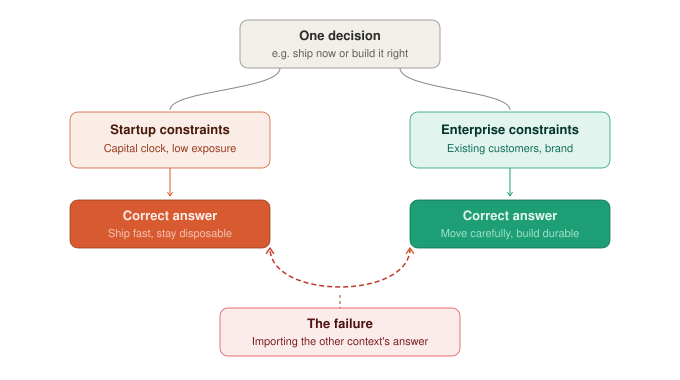
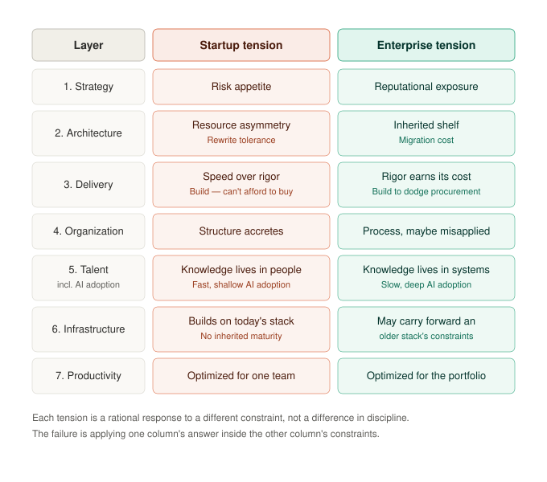
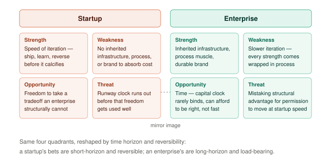
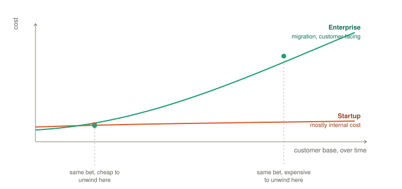
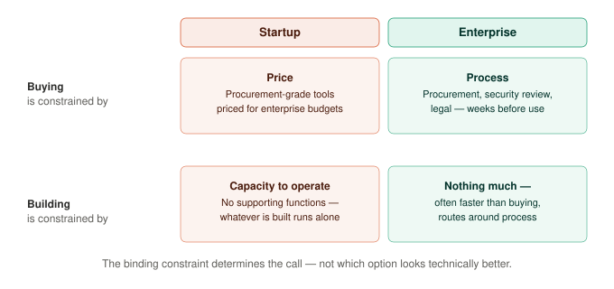
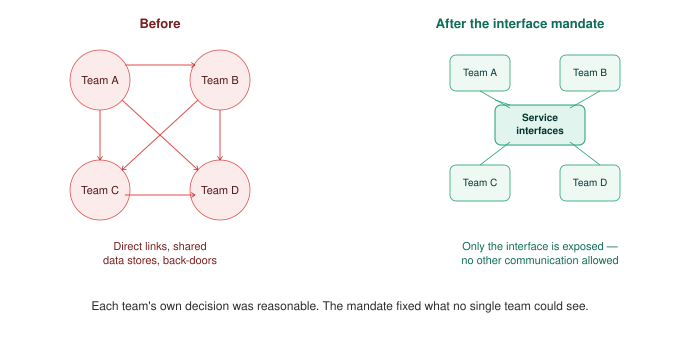
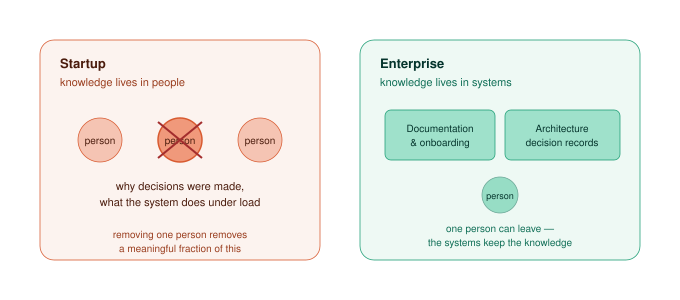
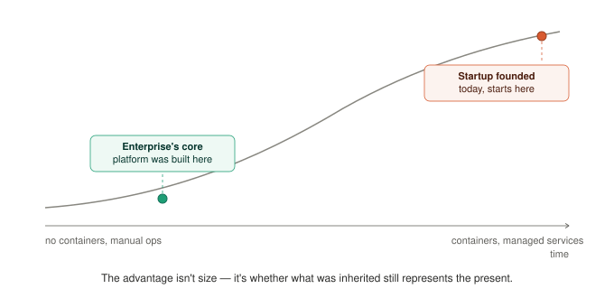
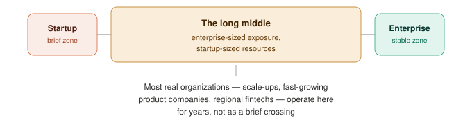
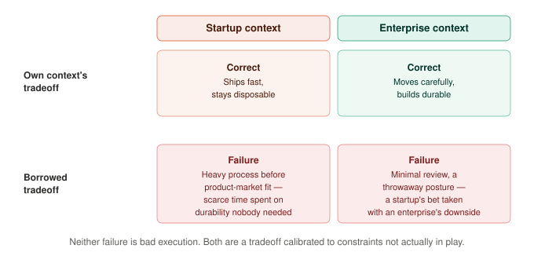

#### The third post in the CTO Decision Stack series. The seven layers don't change between a ten-person startup and a ten-thousand-person enterprise. What changes is what each layer is optimizing for, given different constraints. A startup shipping a throwaway product to win a deal and an enterprise refusing to is not one of them being undisciplined. Both can be right, in their own context — and the recurring failure isn't a bad decision at either end. It's importing a tradeoff that was correct somewhere else.

---

A CTO who has spent a career at startups joins an enterprise and immediately tries to ship fast, skip the architecture review, and treat the first version as disposable. Three months in, a customer-facing outage traces back to exactly that posture, and it costs the company a contract renewal that took two years to win. A CTO who has spent a career at enterprises joins a startup and immediately stands up a formal RFC process, a dedicated platform team, and a multi-stage release pipeline. Eight months in, the startup runs out of runway, having shipped half as much as a leaner competitor with a fraction of the process.

Neither CTO made a technically wrong call in isolation. Both made a call that was correct somewhere else.

This is the actual subject of this post, and it's worth being precise about what it isn't. The [first post in this series](https://aathawerani.github.io/systems/culture/2026/06/07/cto-decision-stack/) closed by noting that the stack behaves differently across organizational contexts, and named one axis of that difference: the startup's risk is invisibility — decisions happening by default because nobody is positioned to make them deliberately — while the enterprise's risk is disconnection — decisions made correctly in isolation by people who don't know about each other. That axis is real, and it shows up below. But it isn't the whole story.

The deeper difference is what each layer is optimizing *for*, given constraints that genuinely differ — not just how visible the optimization is. A startup choosing to build a deliberately throwaway product to win a deal isn't a decision made invisibly by default. It can be fully deliberate and fully correct, for reasons specific to what a startup has and doesn't have yet. An enterprise refusing the same call isn't being slow out of habit. It's protecting something the startup doesn't have yet either.

The seven layers are constant. What's not constant is the answer each layer produces. The map below shows where each layer's tension actually sits before the post walks through all seven in detail — and where a tension recurs at a later layer, it's named once and referenced back to, not redefined.

---

## Layer 1: Corporate & Business Strategy

**Risk Appetite and Reputational Exposure.** An organization with a handful of customers and no public track record has comparatively little to lose from a visible failure. One with an existing customer base, existing contracts, and a brand built over years has a great deal to lose from the same failure. The same decision can carry a different expected cost depending on which of those is true, which means the rational threshold for "good enough to ship" genuinely differs — not because one company cares more about quality, but because the downside of being wrong is sized differently.

This is why a startup can rationally choose, at layer one, to build a deliberately disposable product to win a specific deal, prove a market exists, or simply survive to the next funding round. It's the sacrificial architecture posture the [second post in this series](https://aathawerani.github.io/systems/culture/2026/06/14/ai-across-cto-decision-stack/) described, in [Martin Fowler's terms](https://martinfowler.com/bliki/SacrificialArchitecture.html) — building something now on the explicit understanding it will be discarded later. The posture is more available to a startup than it is anywhere else in a company's life, precisely because the cost of the eventual public failure is low: few customers are exposed, there's little brand to damage, and the capital clock is the binding constraint, so speed is worth more than durability against it.

The same move costs an enterprise more. An enterprise weighing a similarly disposable build for a new initiative isn't weighing it against a clean slate — it's weighing it against an existing customer base who will experience the rough edges, and frequently regulatory or contractual exposure a startup hasn't accumulated yet. An enterprise that ships something throwaway under its existing brand isn't taking the same bet a startup takes. It's taking a worse version of that bet, because the downside is sized to the company it already is. This is why enterprises rationally over-invest in quality and durability at layer one for new initiatives, even ones that are, in every other respect, startup-shaped. The investment isn't conservatism for its own sake. It's pricing the bet correctly against an exposure a startup doesn't carry.

**Invisibility and Disconnection.** The secondary tension at this layer is the one named in the introduction. A startup's layer-one strategy is often founder intuition that's never made explicit — frequently correct, rarely documented, hard to revisit when circumstances change because nobody can reconstruct what assumptions it depended on. An enterprise's layer-one strategy is usually explicit and well-resourced, and its risk runs the other way: strategy decided in a room that doesn't include anyone with current visibility into what the architecture can actually support, producing the disconnection the [first post](https://aathawerani.github.io/systems/culture/2026/06/07/cto-decision-stack/) warned about between the technology SWOT and the business SWOT it's meant to be checked against.

**The Technology SWOT, Run Twice.** The [first post](https://aathawerani.github.io/systems/culture/2026/06/07/cto-decision-stack/) introduced the technology SWOT as the tool that surfaces what a business SWOT can't see on its own — strengths, weaknesses, opportunities, and threats, evaluated from the technology side. The same four quadrants, run separately for a startup and an enterprise, produce almost mirror-image results, and the mirroring is the useful part.

This is where time horizon and reversibility — the two axes the [first post](https://aathawerani.github.io/systems/culture/2026/06/07/cto-decision-stack/) used to open each layer of the stack — do real work. A startup's decisions tend to have short time horizons and high reversibility: a bet that doesn't pay off can usually be unwound within a product cycle or two, because little has been built on top of it yet. An enterprise's decisions tend toward long time horizons and low reversibility, not because enterprises choose this, but because scale itself extends both: more has been built on top of any given decision, more depends on it staying stable, and unwinding it later costs more the longer it's been load-bearing. The technology SWOT for each context isn't really describing two different sets of capabilities. It's describing the same four quadrants, reshaped by how long a decision has to live and how much it costs to take back.

---

## Layer 2: Product Architecture

**Resource Asymmetry.** An enterprise building a new product rarely starts from zero. Identity and authentication, billing, observability, compliance tooling, a design system, a deployment pipeline — these frequently already exist, built and hardened by other teams, available to a new initiative at close to no marginal cost. This changes what's architecturally rational. An enterprise can afford more structural rigor up front on a new product than the same product would justify as an independent startup, because the cost of building "properly" is dramatically lower when most of what "properly" requires is already sitting on the shelf.

A startup has no shelf. Every layer of the architecture is being built for the first time, by a team whose primary constraint is finding product-market fit before the runway runs out. Under-investing in architectural rigor at this stage is frequently the correct call — not a failure to plan ahead, but a recognition that the hours spent on structural cleanliness are hours not spent discovering whether the product needs to exist at all. The [first post](https://aathawerani.github.io/systems/culture/2026/06/07/cto-decision-stack/)'s Stripe example — the early bet that developer experience was the moat — was exactly this kind of startup-stage architectural decision, made deliberately and well, by a small team that chose where to spend its limited rigor budget rather than spreading it evenly.

The risk in both directions is borrowing the other context's answer. A startup that insists on enterprise-grade architectural rigor before it has product-market fit is spending a scarce resource — time — on a problem it doesn't have yet. An enterprise that treats a new product's architecture with startup-style looseness, assuming it'll figure things out later, is declining resources it already owns for no real savings, and inheriting risk it didn't need to take.

**Rewrite Tolerance.** Resource Asymmetry above is about the cost of building. This is about the cost of changing your mind once something is already built and already has users — a related but distinct constraint, because the two don't move together.

A startup with a small, early customer base can treat its own architecture the way the [first post](https://aathawerani.github.io/systems/culture/2026/06/07/cto-decision-stack/)'s Stripe example treated developer experience: as a bet that's allowed to be wrong. If the bet doesn't hold, the cost of rewriting is mostly internal — engineering time, not customer disruption — because there are few customers to disrupt. This is the sacrificial architecture posture from layer one, recurring here in its more literal, mechanical form: not just "we may discard this deliberately," but "discarding this costs us comparatively little, so we can afford to let the architecture be wrong for a while before we know enough to make it right."

An enterprise product running at real scale doesn't have that option. A rewrite isn't mostly internal anymore — it's a migration, with customers who have to be moved and a failure mode that's visible to people who didn't ask to be part of the experiment. This is precisely the condition the [second post in this series](https://aathawerani.github.io/systems/culture/2026/06/14/ai-across-cto-decision-stack/) described [Neal Ford's evolutionary architecture](https://www.oreilly.com/library/view/building-evolutionary-architectures/9781491986356/) as answering: guided, incremental change, checked against fitness functions, rather than a wholesale rewrite that bets everything on the new version before the old one is retired. Part of why the enterprise can't simply abandon the bet is that the same debt that was invisible at startup scale — an ugly schema, a brittle integration nobody outside engineering ever saw — tends to surface at enterprise scale as something a customer, an auditor, or a support team notices directly; it hasn't just gotten more expensive to unwind, it's become externally visible. The failure, predictably, is a startup refusing to rewrite out of misplaced caution it can't afford, or an enterprise attempting a startup-style wholesale rewrite of a system already carrying real customer load.

---

## Layer 3: Technology Delivery

**Speed versus Rigor.** A startup's fast-delivery culture — fewer review gates, lighter test coverage, a willingness to ship before everything is verified — is frequently a rational response to a runway clock. The cost of moving slowly, running out of money or losing a market window to a faster competitor, is usually higher than the cost of the technical debt incurred by moving fast, at least at the scale a startup is operating. This is a real trade-off, made consciously, not a quality failure.

An enterprise's slower delivery cadence — more review, more sign-off, more staged rollout — is the mirror calculation. At enterprise scale, a production incident doesn't affect a small early cohort; it affects existing customers, existing contracts, and frequently SLAs with real financial penalties attached. The cost of moving carelessly is much higher than the cost of moving more slowly, so the rational trade-off shifts toward rigor — gatekeeping that earns its cost, not bureaucracy for its own sake, though as the [second post in this series](https://aathawerani.github.io/systems/culture/2026/06/14/ai-across-cto-decision-stack/) noted, AI's effect on implementation speed is reshaping what "moving carefully" actually requires, and an enterprise that hasn't revisited its review process against that shift is paying for rigor that no longer matches what's actually slow. The failure, in either direction, is a startup adopting rigor it can't afford the time for, or an enterprise importing speed into a context where the cost of being wrong is sized for a much bigger company than the one taking the risk.

**Build versus Buy.** A [dedicated post in this series](https://aathawerani.github.io/systems/culture/2026/06/14/ai-across-cto-decision-stack/) already covered the mechanics of this decision — that AI makes building cheaper without changing the calculus for anything outside an organization's core differentiation, and that the real question is who carries the operational burden once the thing exists. Startup and enterprise answer that question from opposite starting positions.

A startup building something it should have bought is usually doing it for a reason the [second post](https://aathawerani.github.io/systems/culture/2026/06/14/ai-across-cto-decision-stack/) named directly: the build looks fast and the demo works, and the support burden that should have informed the decision doesn't show up until much later, by which point the team has no spare capacity to absorb it. The startup's real constraint on buying isn't preference — procurement-grade vendors price for enterprise budgets, leaving a startup to build what it can't afford to license, whether or not building is the right call on the merits.

An enterprise facing the same decision can usually afford to buy almost anything; the constraint isn't price, it's process. Building, inside an enterprise, is often faster precisely because it routes around that process — not because building is cheaper in any absolute sense, but because it's cheaper *relative to the friction of buying* in that specific organization. [Spotify's Backstage](https://backstage.io) is a clean instance of exactly this dynamic: the internal developer portal that eventually became an industry standard started as an internal tool built to solve Spotify's own service-discovery problem, and one part of its appeal at the time was structural rather than technical — open-source, internally-built software is generally easier to get signed off than a comparable commercial purchase, because the decision doesn't draw the same scrutiny a new vendor contract would. What actually separates the two contexts runs deeper than either price or process, though — it's who is positioned to operate the thing once it's running. An enterprise buying software is rarely just buying the software; it's buying into existing security, platform, and SRE functions that already know how to operate a third-party dependency safely at scale. A startup buying the same software has none of that scaffolding to plug it into. This isn't a claim about what kind of thing is being purchased — plenty of startups buy tools that deliver real operational leverage, plenty of enterprises buy tools that still require real in-house capability to run well. It's a narrower claim: an enterprise usually has supporting functions already built to absorb the operational ownership a purchase brings with it, and a startup usually doesn't, and that asymmetry is what should actually drive the build-versus-buy call in each.

---

## Layer 4: Engineering Organization

**Process Affordability.** A startup cannot afford a dedicated process function. There's no spare capacity to run formal ceremonies, maintain an RFC process, or staff an architecture review board — the team is lightweight because lightweight is what the headcount allows, not necessarily because lightweight is philosophically preferred. Team structure accretes, ownership forms by default, and Conway's Law — the [first post](https://aathawerani.github.io/systems/culture/2026/06/07/cto-decision-stack/)'s observation that any organization designing a system produces a design that mirrors its own communication structure — produces a system shape nobody designed on purpose, simply because nobody had the bandwidth to design it on purpose. The startup's small size means Conway's Law is operating on a communication structure that's mostly informal, so the architecture it produces is whatever a handful of people happened to talk through in the moment.

An enterprise starting a brand-new initiative faces the opposite temptation. The organizational muscle for process already exists and is already funded — sprint ceremonies, RFC templates, architecture review boards, a defined path for getting a new team stood up. Deploying that process on day one of a new product costs the enterprise comparatively little, because the infrastructure for it is sitting there. The risk is that the process was built for a mature, stable product, not a brand-new team still searching for its shape, and applying it uniformly can slow a new initiative down for no benefit the heavyweight process was actually designed to provide.

**Invisibility and Disconnection, again — but here it's disconnection, not invisibility, that does the damage.** Where multiple teams exist at enterprise scale, each making a reasonable layer-four call about their own scope, the failure isn't that the calls were wrong. It's that none of the teams making them knew the other calls were being made. Amazon's response to exactly this failure is one of the more explicit pieces of organizational engineering on record: [a mandate](https://courses.cs.washington.edu/courses/cse452/23wi/papers/yegge-platform-rant.html) that all teams expose their data and functionality only through service interfaces, with no other form of interprocess communication allowed.

The widely cited two-pizza team sizing was secondary to this. The actual countermeasure was the interface mandate itself — a structural rule built specifically to prevent disconnection between teams that each had legitimate, independent ownership of their own slice of the stack. [Stripe's own scaling guide](https://stripe.com/guides/atlas/scaling-eng) names the underlying shift in plainer terms: what works for fifty engineers may not work for ten or a thousand.

---

## Layer 5: People & Talent

This is where several of the tensions above converge. Resource asymmetry shapes who an organization can hire. Process affordability shapes how much governance it can run. Risk appetite shapes how much it's willing to delegate before the consequences of delegating are fully understood. All three meet here, in decisions about who gets hired, where institutional knowledge ends up living, and how readily the organization can adopt AI without losing the judgment AI is meant to assist.

**Resource Asymmetry and Risk Appetite, as in Layers 2 and 1, but together here.** A startup's hiring is opportunistic by necessity — generalists who can cover multiple roles, because there's no budget for narrow specialists and no headcount to spare for a dedicated governance function. Decisions about how much engineering work to delegate to AI agents, and who's accountable when that output fails, get made ad hoc by whoever's closest to the work, because there's no one available to own the question as a distinct layer-five responsibility, exactly as the [first post](https://aathawerani.github.io/systems/culture/2026/06/07/cto-decision-stack/) described.

An enterprise can typically afford what the startup can't: specialist hires, a dedicated AI governance committee, formal learning and development paths. But the existing machinery built for that resource advantage — leveling frameworks, compensation bands, hiring pipelines tuned for stable, well-understood roles — frequently doesn't fit what a new, fast-moving initiative inside the enterprise actually needs. The enterprise has more resources at this layer and a real risk of misapplying them: importing a hiring and governance model built for a mature, low-risk product onto a team that needs to move and adapt the way a startup team would.

**Organizational Memory.** A related but separate question is where an organization's knowledge actually lives, and the two contexts answer it almost opposite ways.

In a startup, knowledge lives in people, because there's been no time and no spare capacity to put it anywhere else — why a decision was made, what was tried and abandoned, what a particular piece of the system actually does under load, all of it sits in the heads of whoever was there when it happened. This is efficient until it isn't: a startup can lose a single engineer and lose a meaningful fraction of its institutional context in the same afternoon, because nothing was written down to survive their departure.

An enterprise's knowledge lives in systems instead — documentation, onboarding material, architecture decision records, the formal processes the [first post](https://aathawerani.github.io/systems/culture/2026/06/07/cto-decision-stack/) described as a layer-two artifact. [Amazon's own writing culture](https://www.aboutamazon.com/news/workplace/an-insider-look-at-amazons-culture-and-processes) is an explicit, designed version of this: the six-page narrative memo required before any major decision exists specifically so the reasoning survives independent of whoever wrote it, and Amazon's own account of why the practice works is direct about the goal — a good process doesn't depend on a single scarce individual, and has a feedback loop built in regardless of who's in the room. An enterprise can usually absorb the loss of any single person without losing the knowledge that person carried. The tradeoff is that building and maintaining those systems is itself a real cost, paid continuously, that a startup's leaner approach simply doesn't carry — until the day it needs to, and discovers the cost was deferred rather than avoided.

**Adoption Friction versus Investment Capacity.** AI adoption splits this layer in a direction that inverts the resource asymmetry rather than repeating it. A startup adopts AI tooling easily — no legacy process to reconcile it with, no governance committee to route through — but can't invest deeply: no budget for a platform to manage agent output at scale, no spare time to build the fitness functions and guardrails the [second post](https://aathawerani.github.io/systems/culture/2026/06/14/ai-across-cto-decision-stack/) described as the real cost of adoption done well. It gets the easy half and has to skip the expensive half. An enterprise has the opposite problem: it can fund the expensive half outright — custom tooling, a staffed governance function, the observability investment that keeps AI-generated code traceable — but every new workflow still has to clear a security review and an approval chain sized for human-authored commits. This is the same process affordability advantage from layer four working against the enterprise rather than for it: the muscle that makes heavyweight process cheap to deploy also makes it expensive to bypass, even when bypassing it is exactly what fast AI adoption needs. Neither path is wrong — a startup's fast, shallow adoption and an enterprise's slow, deep one are both rational responses to what each can actually afford to do well.

**The Supervision Paradox.** The [second post](https://aathawerani.github.io/systems/culture/2026/06/14/ai-across-cto-decision-stack/) named this directly: the skills required to supervise what an agent produces are the same skills delegating to the agent erodes, making unmanaged delegation a one-way ratchet. The mechanism is identical in both contexts; only the clock differs. A startup's small team delegates heavily from day one because there's no spare headcount not to, and because the team is small, the erosion concentrates in very few people — the organization's entire supervisory capacity can thin out within one team's tenure, with no bench to fall back on. An enterprise has that bench, but trades it for the pipeline problem the [second post](https://aathawerani.github.io/systems/culture/2026/06/14/ai-across-cto-decision-stack/) raised: the entry-level work that used to build supervisory judgment is exactly the work AI now does fastest, and a large organization can run that substitution for years before the gap is visible, because enough senior engineers can still catch agent errors that nobody notices the layer beneath them isn't being trained the same way. The startup's version of the paradox is fast and visible. The enterprise's is slow, and doesn't surface until the engineers who can still catch a mistake leave faster than they can be replaced.

---

## Layer 6: Infrastructure

The same resource gap that shapes who an organization can hire shapes what it can build on.

**Resource Asymmetry, as in Layer 2 — and this is the layer where it's most durable and least disputable.** A startup provisions everything from scratch on commodity cloud, under real cost sensitivity, fragile under any load pattern nobody anticipated — not from carelessness, but because there's no existing investment to inherit and no slack to over-provision against uncertainty. An enterprise building something new inherits infrastructure maturity for free: cloud commitments and the negotiating leverage that comes with them, an existing security and compliance posture, and — the clearest instance of this inheritance — observability. A failure in a brand-new enterprise product can often be traced with the same maturity as a failure in a ten-year-old one, because tracing infrastructure doesn't care how old the product is, while a startup's first real production failure is frequently also the first time anyone learns what the system does under load, debugged live with a customer watching. This is the enterprise equivalent of the layer-six economics the [first post](https://aathawerani.github.io/systems/culture/2026/06/07/cto-decision-stack/) described in [Dropbox's decision](https://www.datacenterknowledge.com/cloud/dropbox-s-reverse-migration-from-cloud-to-own-data-centers-five-years-on) to own its storage infrastructure once the cost curve justified it: a new enterprise initiative starts much further along that curve than a startup ever can.

The risk runs in two directions, both familiar by now. The platform team that owns the inherited infrastructure optimizes for cost and standardization while the product team optimizes for delivery speed, and the two can work against each other even in good faith. And the inheritance itself is tuned to the failure modes of the enterprise's existing, mature systems — a genuinely new kind of product, with unusual load patterns or a different architecture, can fall into gaps the inherited stack was never built to see. The advantage is real. It isn't automatically the right advantage for what's actually being built on top of it.

**What Infrastructure Makes Thinkable.** There's a second, deeper claim hiding underneath Resource Asymmetry. The point above was about who has more infrastructure right now. This one is about something infrastructure does that has nothing to do with quantity: it determines which architectures are available to choose from at all, and that availability changes over time, in both directions.

[Neal Ford's evolutionary architecture](https://www.oreilly.com/library/view/building-evolutionary-architectures/9781491986356/) work makes the forward-pointing version of this directly: architects working before containerization existed couldn't have built today's default microservices patterns no matter how skilled they were, because the infrastructure those patterns depend on simply wasn't there yet — the patterns weren't undiscovered, they were unbuildable. A startup founded this year inherits that maturity for free. An enterprise's core platform, built at an earlier point on the same curve, may still be carrying the constraints of whatever year it was actually built, unless it's been actively modernized since.

The same idea runs in the other direction too, and Amazon's own infrastructure has supplied the clearest recent illustration of it. [Prime Video's video quality monitoring team](https://www.wudsn.com/productions/www/site/news/2023/2023-05-08-microservices-01.pdf) had built its system as a distributed, serverless set of microservices — the architecturally fashionable choice and, at the scale they started at, a reasonable one. As the service scaled to monitor thousands of streams simultaneously, the architecture's own coordination overhead became the cost, not the actual analysis work. Moving the service to a monolith cut infrastructure cost by over ninety percent and increased scaling capacity at the same time — not because microservices are wrong, but because the architecture correct at the scale Prime Video started at stopped being correct at the scale it grew into, and nobody had revisited the choice until the cost made it impossible to ignore. Prime Video didn't abandon microservices as a whole; one service was refactored because it was the better fit for what that service had become. The lesson isn't that monoliths outperform microservices, any more than the earlier point was the reverse. Architectural decisions are conditional on scale, workload shape, and infrastructure economics — and all three change, in both directions, which is what the diagram above and Prime Video's experience are each describing from opposite ends.

---

## Layer 7: Developer Productivity

The infrastructure question has a close cousin one layer up: what an organization can build on shapes what its own engineers build with.

**Process Affordability and Resource Asymmetry, as in Layers 4 and 2, pulling in opposite directions here.** A startup's tooling is whatever's free and fast to adopt — there's no capacity to invest in anything custom, so the developer experience is whatever the default setup provides, rarely a deliberate choice so much as the absence of one. An enterprise can lean on existing CI/CD, existing internal developer platforms, tooling investment built over years — a real advantage, but only when it actually fits the new initiative's architecture the way the [first post](https://aathawerani.github.io/systems/culture/2026/06/07/cto-decision-stack/)'s Google example required.

**Local versus Global Optimization.** The deeper reason that fit is so easy to get wrong is structural, not just a matter of checking carefully. A startup's tooling decision optimizes for exactly one team — there's only one team to optimize for, so the fastest available solution for that team is, by definition, the right answer. An enterprise's platform team is solving a different problem entirely: not what's fastest for any single team, but what's good enough across dozens or hundreds of teams with different needs, none of which can be fully served by a solution tuned to any one of them. The heavyweight pipeline that feels like unnecessary friction to a new, fast-moving team isn't usually a failure to optimize. It's evidence of an optimization that was never aimed at that team specifically — a platform built to be tolerable everywhere rather than excellent anywhere, which is the correct objective at that scale and the wrong fit for a team that's still small enough to be optimized for directly. The investment is real and well-funded either way. Whether it serves the team using it depends on whether anyone recognized which kind of optimization the team actually needed before applying the other one.

---

## The Transition

The tensions above don't resolve gradually as a company grows. There's a specific stretch where a company is too big for the tradeoffs that made sense as a startup and not yet positioned to draw on the advantages that make sense as an enterprise — and that stretch is the hardest part of the journey, for a structural reason worth naming directly.

The startup-rational tradeoffs — ship fast, skip the architecture review, treat the first version as disposable, keep process light because there's no one to run it — stop being rational the moment the constraints that justified them change. Reputational exposure grows as the customer base grows. The cost of a production incident rises as revenue starts depending on uptime. The capital clock that made speed worth more than durability stops being the most urgent constraint once there's a real, paying customer base to protect. A company can cross this line without anyone deciding to.

But the enterprise-rational advantages — existing infrastructure to lean on, existing process muscle to deploy cheaply, existing specialist talent to hire — usually aren't available yet either. The infrastructure hasn't been built. The process functions don't exist. The talent pipeline hasn't been established. A company in this stretch is carrying enterprise-sized exposure with startup-sized resources, which is precisely the gap that produces the costliest version of every failure described above: the public outage that costs a renewal, the runway burned on process the team didn't need yet, the throwaway build shipped under a reputation the company can no longer afford to risk.

It's worth being honest about how long this stretch actually lasts. The framing so far — startup, then transition, then enterprise — makes it sound like a brief crossing. It isn't, for most organizations that experience it. A scale-up with a few hundred people, a fast-growing product company, a regional fintech with real customers and real revenue but nothing like an enterprise's inherited infrastructure or process muscle: for companies like these, the transitional condition isn't a phase to get through. It's the operating environment, for years, possibly for the company's entire life if it never reaches the scale where the enterprise-side advantages actually arrive. The seven layers and the tensions running through them apply just as much here as at either extreme — arguably more, since this is the zone where the cost of getting the calibration wrong is highest.

[Stripe's own framing of this point](https://stripe.com/guides/atlas/scaling-eng) holds for the whole stack, not just engineering organization: accept that nearly everything set up today will stop working at some point, so design for flexibility, not perfection. The tradeoffs that got a company here were not wrong. They were scoped to a set of constraints the company has since outgrown, while the constraints that would justify the next set of tradeoffs haven't fully arrived.

---

## The Collapse Pattern, Revisited

The [first post](https://aathawerani.github.io/systems/culture/2026/06/07/cto-decision-stack/) described three breakdown patterns common to any organization: strategic decisions masquerading as technical ones, technical decisions resolved at the wrong layer, and layer collapse under delivery pressure. A fourth pattern is specific to context, and it has two mirror-image forms.

**Borrowing the wrong context's tradeoff.** Neither failure here is a failure of execution. Both are a failure to notice that the tradeoff being applied was calibrated to a different set of constraints than the ones actually in play.

**The visibility failures**, still real, now correctly sized as one pattern among several rather than the whole story. The unstacked startup, where all seven layers are being decided invisibly by one or two people's intuition, which works until the company outgrows what that intuition can personally span. The stacked-but-silent enterprise, where every layer has an owner making individually defensible calls, and the coordination cost of those calls never being compared is the kind of silo-driven inefficiency several research firms have separately estimated at somewhere in the range of a fifth to a third of total organizational capacity[^1] — directionally consistent across sources even where the precise figure isn't, and large enough that it rarely traces back to any single decision that was wrong.

Both forms of the fourth pattern share the same root: a company that cannot explain, after the fact, why it ended up where it did — not because no one was deciding, and not because the decisions were bad, but because the decisions were each correct against a frame that nobody checked against the company's actual, current constraints.

One honest caveat belongs here. This post has argued, layer after layer, that startup and enterprise tradeoffs are each rational against their own constraints — and that framing does real work, but it isn't a license to assume every decision is secretly optimal once you squint at it the right way. Constraints explain a great deal. They don't excuse all of it. Founders stay attached to a call past the point it stopped serving them. Executives protect a structure for political reasons that have nothing to do with the constraints that originally justified it. Enterprises accumulate process nobody actually needs anymore and keep running it because removing it is its own kind of organizational labor nobody wants to spend. The diagnostic in this post is for telling apart a decision that's correct for its context from one that's wrong for any context — not for assuming the first category is the only one that exists.

---

## Using the Stack Across Contexts

The [first post](https://aathawerani.github.io/systems/culture/2026/06/07/cto-decision-stack/)'s diagnostic — for any significant decision, ask what layer it actually lives in, and whether it's being evaluated at that layer — still applies without modification. What this post adds is a question that has to come before it, and the question is the same one at every layer: **what do our actual constraints allow and require here, and is the tradeoff I'm reaching for one that was correct in a different context?**

A startup CTO reaching for an enterprise's rigor, and an enterprise CTO reaching for a startup's speed, are making the same mistake in opposite directions: solving for a set of constraints they don't actually have. The seven layers don't change. What changes, predictably, is the answer each layer should give — and the CTO whose answer comes from the last company rather than this one will find a way to be wrong even while doing everything right.

"Startup" and "enterprise" have been the names used throughout this post, because they're the names most CTOs already use for the two ends of this range. But the actual mechanism was never about which label applies. It's that a given constraint — low reputational exposure, a runway clock, an inherited platform, an established process function — produces a given answer, regardless of what the company calls itself. A two-hundred-person scale-up with enterprise-grade reputational exposure and startup-grade resources is not a confusing edge case for this model. It's the model working exactly as described, for an organization that happens to sit in the middle of the range rather than at either end.

---

## Sources

[^1]: Estimates of silo-driven coordination loss vary by source and methodology, but several independent estimates land in a similar band. McKinsey's *State of Organizations 2026* and related operations research describe fragmented, cross-functional friction as consuming a substantial share of productive capacity ([McKinsey & Company](https://www.mckinsey.com/capabilities/operations/our-insights/transform-the-whole-business-not-just-the-parts)). A cross-source synthesis citing McKinsey, Bain, PwC, Gartner, and Okta research puts the figure at roughly 20–30 percent of operating expenditure lost annually to rework, miscommunication, and fragmented processes ([Crebos](https://crebos.online/resource-center/the-true-cost-of-operational-inefficiency/)).

**Martin Fowler, sacrificial architecture** — the concept of deliberately building a first version with the explicit intention of discarding it once it has served its purpose. [martinfowler.com](https://martinfowler.com/bliki/SacrificialArchitecture.html)

**Neal Ford, Rebecca Parsons, and Patrick Kua, evolutionary architecture** — the framework for guided, incremental architectural change verified against fitness functions, including the argument that infrastructure availability (such as containerization) determines which architectural patterns are buildable at a given point in time. *Building Evolutionary Architectures* (O'Reilly).

**Stripe's engineering scaling guide** — including the framing that practices suited to fifty engineers may not suit ten or a thousand, and the caution against building out an engineering organization faster than it can absorb. [stripe.com/guides/atlas/scaling-eng](https://stripe.com/guides/atlas/scaling-eng)

**Amazon's service interface mandate** — the internal directive attributed to Jeff Bezos, requiring all teams to expose functionality only through service interfaces with no other form of interprocess communication allowed. The original 2011 internal Google memo by Steve Yegge that brought this account public was later taken down; it is preserved at multiple archival mirrors, including [this course-hosted copy](https://courses.cs.washington.edu/courses/cse452/23wi/papers/yegge-platform-rant.html) and [this archived gist](https://gist.github.com/kislayverma/d48b84db1ac5d737715e8319bd4dd368).

**Amazon Prime Video, Video Quality Analysis architecture** — the team's move from a distributed serverless microservices orchestration to a monolith, reducing infrastructure cost by over 90 percent and increasing scaling capacity. The original article on primevideotech.com has since been taken down; the full text is preserved in [this archived PDF](https://www.wudsn.com/productions/www/site/news/2023/2023-05-08-microservices-01.pdf).

**Amazon's Working Backwards process** — the six-page narrative memo and PR/FAQ practice designed so that institutional reasoning survives independent of any single person, described in Colin Bryar and Bill Carr, *Working Backwards: Insights, Stories, and Secrets from Inside Amazon* (St. Martin's Press, 2021). An excerpt describing the process in Amazon's own words is published at [aboutamazon.com](https://www.aboutamazon.com/news/workplace/an-insider-look-at-amazons-culture-and-processes).

**Spotify's Backstage** — the internal developer portal originally built to solve Spotify's own service-discovery problem, later open-sourced and donated to the Cloud Native Computing Foundation. [backstage.io](https://backstage.io) and [Spotify Engineering](https://engineering.atspotify.com/2025/4/celebrating-five-years-of-backstage)

**Dropbox's Magic Pocket migration** — the move of roughly 90 percent of Dropbox's stored data off Amazon S3 onto self-built infrastructure between 2015 and 2016, disclosed in Dropbox's 2018 S-1 filing as saving approximately $75 million in operating costs over the following two years. Reported in [Data Center Knowledge](https://www.datacenterknowledge.com/cloud/dropbox-s-reverse-migration-from-cloud-to-own-data-centers-five-years-on) and discussed, without external citation, in the first post of this series, *The CTO Decision Stack*.

**Google's internal developer tooling (Blaze/Bazel, Critique, Piper)** is discussed at length, without external citation, in the [first post of this series](https://aathawerani.github.io/systems/culture/2026/06/07/cto-decision-stack/), *The CTO Decision Stack*.

---

*Ali Ahmed Thawerani writes about the systems, culture, and scale decisions that shape how technology organisations develop. TECTONICS publishes at [aathawerani.github.io](https://aathawerani.github.io).*
