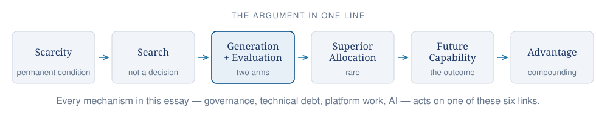
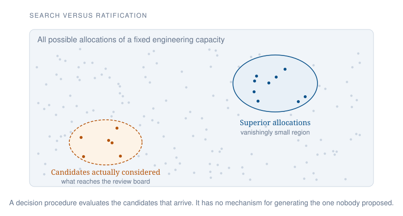
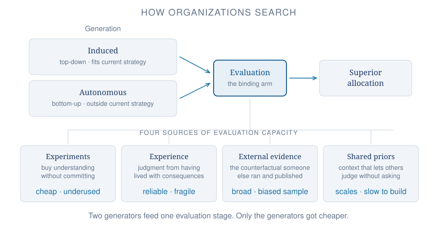
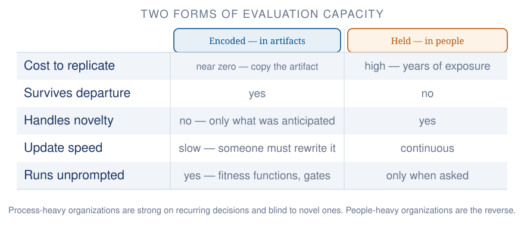
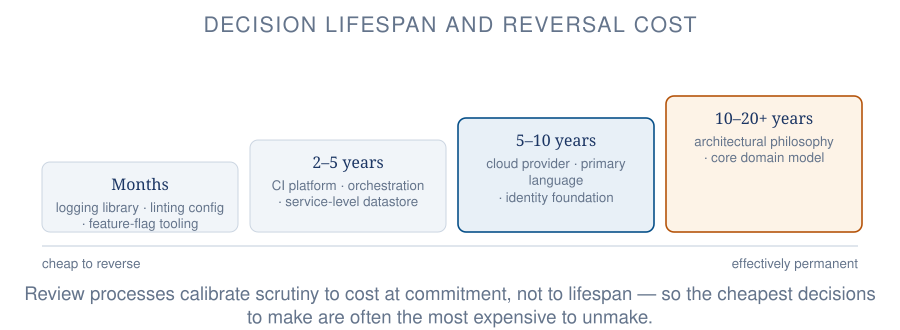
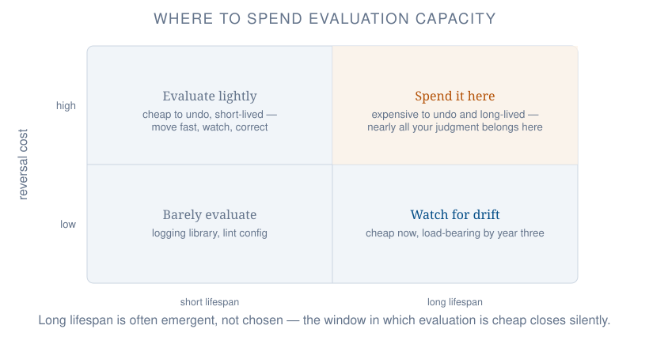
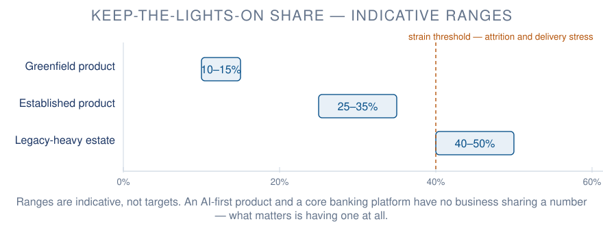
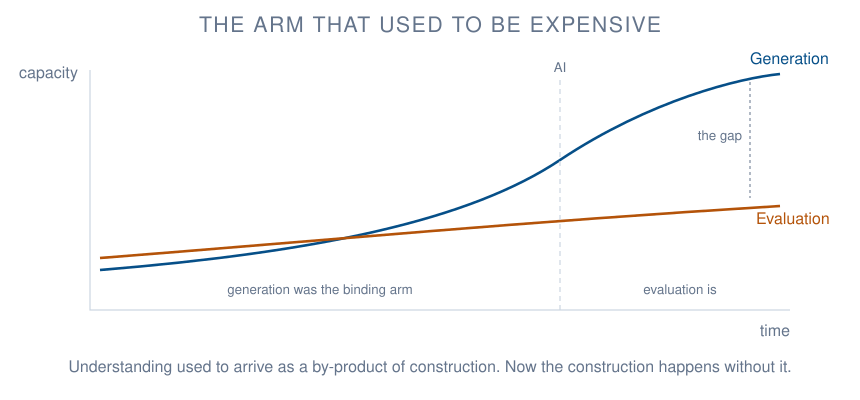
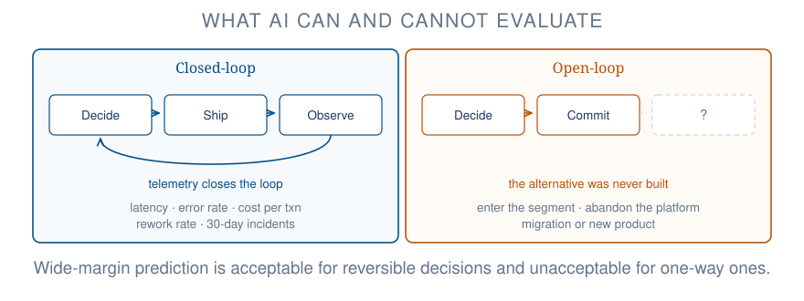
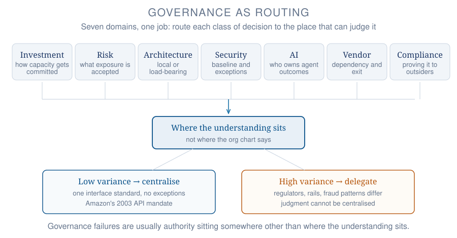

## The Same Inputs, Different Companies

Take an engineering organization of sixty people: a couple of hundred services in production, an on-call rotation, a platform team, a primary framework two major versions behind, a data migration deferred twice, and a compliance deadline eleven months out. Decide how the sixty are distributed across all of it.

Now take a second organization with the same sixty people, the same budget, the same stack, the same market and the same backlog. Give it a different distribution.

Five years later these are not two versions of the same company. One has a platform that makes each new service cheaper than the last; the other has forty services that each cost full price to build and full price to keep alive. One absorbs a regulatory change in a quarter; the other discovers the change requires touching systems nobody fully understands, and spends three quarters finding out what they do. The gap did not come from talent, effort or process discipline. Both organizations worked hard and shipped continuously. The gap came from which allocation they found.

This is what strategy literature means by **superior allocation** — the observation that among the many ways an organization can distribute scarce resources, only a small number produce materially better long-run outcomes, and that finding one of those is the actual source of advantage rather than working harder inside whichever one you happen to have inherited.

The effect size is not subtle. McKinsey's long-running study tracked roughly 1,500 companies over two decades and found firms in the top third by reallocation activity delivered around 10 percent in average annual shareholder returns against roughly 6 percent for the bottom third — compounding to a company worth about twice as much within twenty years [[1]](#ref-1). The distribution behind that number is the part worth sitting with: a third of those companies moved about one percent of their capital between businesses year over year. Most large organizations re-approve last year's allocation with minor adjustments, for decades.

That is not allocation. It is ratification.

> Superior allocations exist and are rare. Almost every organization is operating in one it never chose, arrived at by accumulated default.

The argument below runs in one line, and it is worth seeing whole before it is taken apart.

  

---

## Your Strategy Is Where Your Engineers Actually Are

Before going further it is worth dispatching a comfortable belief: that allocation is downstream of strategy — leadership decides direction, engineering executes, and capacity distribution is the plumbing in between.

Joseph Bower's research at Harvard, beginning in 1970 and extended for three decades by Robert Burgelman, Clark Gilbert and Clayton Christensen, found close to the opposite [[2]](#ref-2). A company's realized strategy emerges far less from formal statements of corporate strategy than from the accumulated pattern of resource commitments made across every level of the firm. Strategy is not decided and then allocated. Strategy is what the allocations turn out to have been.

The clearest software demonstration is AWS. In 2003 two Amazon infrastructure engineers, Benjamin Black and Chris Pinkham, wrote a short paper describing infrastructure that was completely standardized, completely automated, and relied extensively on web services [[3]](#ref-3). Bezos approved an experiment; Pinkham relocated to Cape Town and built EC2 there, deliberately away from Seattle. Amazon's stated strategy was retail. The engineering capacity went to infrastructure anyway, and the strategy amended itself afterwards.

Two details matter more than the story's familiarity. The version most people know is false — the claim that AWS came from renting out spare retail capacity has been denied by Black himself, who says every part was purpose-built. And it was not a lone bottom-up insight either: Andy Jassy was concurrently writing a vision document for the same business, presented to the executive team that September and approved for 57 hires. Two allocation processes ran at once, from opposite ends of the organization, and the strategy followed both.

For a CTO this is an uncomfortable diagnostic, and I include myself in it. Your technology strategy is not the deck you presented to the board. It is the sum of where your engineers spent last quarter. When the two disagree, the deck is the fiction — and it is usually the fiction being reported upward.

---

## What Makes One Allocation Superior

If allocations differ so much in outcome, it is worth being precise about what actually varies between them, because the answer explains why judging them is hard.

Two allocations can produce nearly identical output this quarter and leave the organization in completely different positions in three years. The difference is not in what gets shipped. It is in what each allocation does to the organization's **future capability** — its capacity to do the next thing, and the thing after that.

Platform investment increases future capability; each subsequent service costs less than the last. Technical debt consumes it; every deferred decision raises the price of the ones that follow. Architecture shapes it by fixing which future changes are cheap and which are structurally expensive, and knowledge concentration constrains it by tying the organization's ability to act to specific people.

This is why superior allocation is genuinely difficult rather than merely uncommon. The variable that distinguishes a good allocation from a mediocre one is not visible in this quarter's output. It sits in the future, in a counterfactual, in the cost of work that has not been attempted yet. Any organization can measure what it shipped. Almost none can measure what its choices did to what it will be able to ship.

---

## Why Governance Doesn't Find Superior Allocations

If superior allocations are rare and valuable, the obvious question is how an organization finds one. The obvious answer — better process at the point of decision — is where most organizations have invested, and it does not work, for reasons that are structural rather than a matter of execution quality.

For sixty engineers across even a handful of investment categories, the number of possible distributions is combinatorially enormous, and the number that are genuinely superior is vanishingly small by comparison. Finding one is therefore a **search problem**: it requires visiting many points in that space and being able to tell them apart.

Herbert Simon described the consequence sixty years before anyone was allocating engineering capacity [[4]](#ref-4). Real decision-makers cannot evaluate all available alternatives, so they do not optimize — they *satisfice*, generating options until one clears an acceptability threshold, then stopping. Bounded rationality is not a criticism of managers; it is a description of what is physically possible. Which means the question is never whether an organization searches exhaustively, because none does. It is how much of the space it covers before its threshold is met, and how good that threshold is.

Now look at what the standard apparatus actually does. Investment committees, architecture review boards, portfolio dashboards, quarterly planning, OKRs — these are *decision procedures*. A decision procedure evaluates the candidates that arrive in the room. It has no mechanism whatsoever for generating the candidate nobody proposed. An organization can run an immaculate governance process, with the right thresholds and the right cadence and genuinely capable people, and spend a decade choosing among three options in a space containing thousands — never discovering that the superior allocation was one that was never tabled.

> Governance improves the quality of evaluation. It does not search the solution space. Those are different jobs, and in most organizations only one of them has been staffed.

The default state is worse than this suggests. Peter Weill and Richard Woodham's research on IT governance found that organizations tend to fall into recognisable archetypes — a monarchy where a small executive group decides everything, a feudal model where each unit decides independently, a federal blend of the two, or an anarchy in which decision rights were simply never assigned [[5]](#ref-5). The uncomfortable finding is that anarchy is the most common state, not because anyone selected it but because it is what happens in the absence of a deliberate choice. Organizations are ungoverned by omission in exactly the way they are allocated by default. Both are the same failure: a structure nobody chose, inherited rather than searched for.

  

---

## Two Generators

Search decomposes into generating candidates and evaluating them. The generation half is better understood than most engineering leaders realise, because Burgelman named its two modes decades ago [[6]](#ref-6).

The **induced** process generates candidates that fit the current strategy. It runs top-down — leadership articulates a direction and the organization produces options consistent with it — and it is what people mean when they say a CEO's mindset trickles down. It reduces variation and exploits what the organization already knows.

The **autonomous** process generates candidates outside the current strategy, from people close enough to the frontline to notice a gap between the stated strategy and what the environment is doing. Black and Pinkham writing an infrastructure paper at a retailer is this. So is Amazon opening its storefront to third-party sellers, including direct competitors, which was contested internally and is now a majority of units sold.

Burgelman's finding is the useful part: successful organizations run both at once, and strategic reorientations are usually preceded by experimentation and selection through the autonomous process. With only the induced process an organization searches a narrow band around where it already is; with only the autonomous one it generates variety it cannot integrate.

This also names the executive's actual job in a way most job descriptions do not. Burgelman calls it *strategic context determination*: evaluating the adaptive potential of autonomous initiatives and amending corporate strategy only once one has proven reasonably viable. That is not deciding. It is evaluating — which is a different skill, and, as the next section argues, the one that has recently become scarce.

---

## The Arm That Used to Be Expensive

Search has two arms and they are not symmetric in difficulty. Which one binds has changed, and almost every mechanism organizations currently rely on was built for the old answer.

For most of the history of software, generation was the expensive arm. Producing a serious candidate — a working prototype, a migration actually attempted, an architecture built far enough to judge — cost months. Evaluation was nearly free by comparison: by the time you had built the thing you understood it, because building it was how you came to understand it. Understanding arrived as a by-product of construction.

Look at what the industry built under that assumption. Reusable components, frameworks, package ecosystems, low-code platforms, and eventually code generation — a whole discipline aimed at making candidates cheaper to produce. The evaluation apparatus stayed thin because it did not need to be thick: code review, some architecture review, and the tacit judgment of whoever had built the last three systems.

AI inverted the ratio. Generation is cheap and getting cheaper. Evaluation costs what it always did, because understanding no longer arrives as a by-product of construction — the construction happens without it. What remains is an apparatus optimised for the arm that stopped being scarce.

> Search consists of generation and evaluation. Generation used to be the binding constraint. It no longer is, and the mechanisms built for it have not been replaced.

I want to be careful with the primacy claim, because there are other plausible candidates for what limits allocation. Incentives determine which candidates get proposed. Politics determines which survive contact with the people whose budgets are affected. Information matters too. Each genuinely constrains allocation and I am not arguing otherwise.

The test I would apply is what happens when you relax the others. Fix the incentives and you get a wider candidate set you still cannot judge. Remove the political friction and decisions move faster in directions nobody has verified. Add information and you have fed a process whose bottleneck is downstream. Raise evaluation capacity, though, and the others become legible: an organization that can judge options can see that its candidate set is skewed, and can tell which objections are analysis and which are territory. Incentives shape what appears, politics shapes what survives, information feeds the judgment — and evaluation is the step none of them substitute for.

---

## Where Evaluation Capacity Comes From

The evaluation half has no equivalent vocabulary, which is part of why it goes unmanaged. It deserves a name, because everything below depends on it:

> **Evaluation capacity** is an organization's ability to judge options it has not taken. It is the scarce input that determines whether allocation is search or ratification.

Stated that way the supply problem becomes tractable, because judgment about an option you have not taken cannot come from the option itself. It has not happened. It has to come from somewhere else, and as far as I can tell there are only four somewhere-elses: take a small piece of the option cheaply, have taken something like it before, find someone who took it and said what happened, or borrow judgment from someone who already has it. Buy it, remember it, borrow it, distribute it. Each buys a different kind of certainty at a different price.

Buying it is what an **experiment** does. The spike, the pilot, the limited rollout, the prototype whose purpose is information rather than delivery — each converts an unknown into evidence at a fraction of the cost of committing. It is the only source that produces evidence about *this* option in *this* system, which makes it the most precise of the four and, in most engineering organizations, the most underused, because work that produces a decision rather than a feature is hard to defend in a delivery-focused planning meeting.

Remembering it is what **experience** does, and it is really an experiment already paid for. An engineer who has been on the wrong end of a migration is carrying evidence about the next one that nobody has to purchase again. That makes experience the cheapest source at the point of use and the most expensive to acquire — and the most fragile, because it lives in people, is rarely written down, and leaves when they do. An organization whose judgment about architectural trade-offs sits in four heads has a search capability that two resignations can halve. Knowledge concentration is not a staffing inconvenience; it is a direct constraint on how many options the organization can consider.

Borrowing it is what **external evidence** does — the counterfactual someone else ran and published. When Amazon Prime Video's monitoring team documented moving from distributed serverless components back to a monolith and reported roughly a ninety percent reduction in operating cost, every organization that read it acquired an evaluation input it never had to pay to generate [[7]](#ref-7). The industry's habit of publishing architectural post-mortems is, in aggregate, a shared evaluation commons, and it is why this source has grown faster than the other three. It is also the least transferable, for reasons the later discussion of open-loop decisions returns to.

Distributing it is what **shared priors** do, and this is the only source that scales without adding people. When leadership's reasoning about trade-offs is legible enough that engineers three levels down apply it unaided — Netflix's formulation is context, not control — the organization has spread its judgment rather than centralised its approvals, and can therefore evaluate in many places at once. This is what makes autonomy work when it works. It is not a values statement; it is a transmission mechanism, and an organization that cannot articulate its own reasoning has nothing to transmit.

Notice what the four have in common: none of them is a decision process. They are all ways of acquiring evidence about a road not taken. Which is why an organization can improve its governance indefinitely and not become better at allocation — it is refining how it chooses between candidates while doing nothing about how well it can tell them apart.

  

---

## Encoded and Held

There is a second distinction cutting across those four sources, and it explains something engineering leaders argue about constantly without resolving.

Evaluation capacity is either **encoded** in artifacts or **held** in people. Encoded capacity is the architectural fitness function running in CI, the runbook, the architecture decision record, the review checklist, the deployment gate. Held capacity is the staff engineer who knows why the payment reconciliation service behaves the way it does at month end.

They fail in opposite directions.

  

This resolves a question that otherwise looks like a matter of taste. A process-oriented organization can hire inexperienced engineers successfully, because the encoded capacity carries the judgment they do not yet have. A people-oriented organization making the same hire does worse — not because the person is worse, but because there is nothing for them to inherit. Neither model is superior in general; they are strong and blind in opposite places.

The most interesting artifacts encode judgment about the future rather than the past. An architectural constraint expressed as an executable check is judgment someone wrote down once that now runs without its author. That is the strongest form encoded capacity takes, and its limit is the limit of the form: it evaluates what was anticipated and is silent about what was not.

---

## Where to Spend It

Evaluation capacity is scarce, which means it has to be allocated too — and spreading it evenly across every decision is the most common way to waste it.

The rule that matters is reversal cost: what would it cost — in time, money and disruption — to undo this eighteen months from now if the assumption behind it turns out wrong. Low-reversal-cost decisions barely warrant evaluation; make them fast and correct cheaply. High-reversal-cost decisions warrant nearly all of it, because a wrong answer will still be constraining the organization long after everyone has forgotten the reasoning.

What makes this difficult is that reversal cost has almost nothing to do with how large a decision feels at the time. Technology decisions have wildly different lifespans, and the range spans two orders of magnitude.

  

Past the middle of that range, a decision usually stops being visible at all — re-litigating it would mean re-litigating everything built on top, so nobody does.

The mismatch is that most review processes calibrate scrutiny to *cost at the moment of commitment*, not to lifespan. Choosing a primary language for a new service can be nearly free — a config file and an afternoon of debate — while carrying a fifteen-year reversal cost. An expensive one-off infrastructure migration might carry a three-year one. Calibrating by immediate cost systematically under-evaluates exactly the decisions that deserve the most evaluation.

Reversal cost is not the whole picture, though. It asks what it takes to undo a decision; **optionality** asks what future choices the decision leaves available, and the two come apart more often than they coincide. A vendor contract can be cheap to exit and still foreclose an entire category of architecture, because the integration pattern it encouraged has propagated everywhere. A platform can be expensive to unwind and still be the thing keeping three directions open. Reversal cost is about the past commitment; optionality is about the shape of the future.

This is why platform work resists justification through delivery metrics. A platform's return is not cheaper output this quarter. It is that a set of future decisions became affordable, and their consequences more predictable — which lowers the evaluation cost of everything built on top. Platform investment is evaluation-capacity infrastructure, and architecture that preserves optionality is the same purchase seen from another angle. Neither shows up in any measure of what shipped.

One more effect is worth noticing: lifespan is often emergent rather than chosen. A database engine picked provisionally in year one is load-bearing by year three, because forty services now assume its consistency guarantees. Decisions become expensive to reverse while nobody is watching, so the window in which evaluation is cheap closes silently.

  

---

## The Economics of Searching Well

Search costs something, which means a CTO is choosing how much of a scarce resource to spend on finding better ways to spend a scarce resource. Three ideas from economics do genuine work here, and they are not decorative.

**Scarcity is the permanent condition, not a temporary shortfall.** Additional headcount moves the frontier of what is possible and immediately generates a larger set of things worth doing that still exceeds what is available — which is why "how do we get enough capacity" has no stable answer.

**Opportunity cost is the only honest price of a candidate.** Reviewed one at a time, almost every proposal clears the bar. The question that discriminates is not "is this worth doing" but "is this worth more than the next-best use of the same capacity" — and that alternative never names itself. Asking for it out loud is the cheapest search discipline available, because it forces a second candidate into existence at the moment the first is being approved. Without it, sequential local approval drifts somewhere nobody chose: every individual yes was defensible, and the accumulated pattern is an allocation no one would have selected deliberately.

**Incentives determine which candidates exist at all**, which makes them the most consequential of the three and the easiest to miss. Teams propose what they are rewarded for proposing. If promotion follows visible launches, the candidate set reaching any review board is biased toward new surface area and away from platform work, debt reduction and decommissioning — not through bad faith, but because people rationally generate the options that are good for them to have proposed. The bias runs both ways: there is a well-worn path for the person who shipped an ambitious platform and essentially none for the person who recognised early that a funded initiative should stop. An incentive structure is a filter sitting upstream of governance, quietly determining which regions of the space are ever visited. Fixing the review board while leaving the filter in place changes little.

To make any of this concrete, the split has to be measured rather than felt: a small number of tracked buckets — non-negotiable work to keep the business running, and elective investment across new capability, improvements to existing systems, and internal productivity.

  

The ranges above are indicative, not targets, and they move with domain, regulatory load and estate age — an AI-first product and a core banking platform have no business sharing a number. What matters is not landing on the right percentage but having one at all. A CTO who can state the current split, the intended split, and the direction of travel is in a different conversation from one who can only describe it qualitatively.

---

## What AI Actually Changed

Now the central asymmetry can be stated, and it is the reason the last three years feel confusing rather than simply good.

AI is an extraordinarily powerful generation engine. It lowers the cost of producing a candidate — a prototype, a migration path, an alternative architecture, a working proof that something is possible — by an order of magnitude. In search terms it massively expands the number of points in the allocation space an organization can afford to visit. That is real, and it is the half everyone is discussing.

AI simultaneously degrades evaluation capacity, and that half is invisible in every metric currently in use.

The mechanism is the one I set out in [The Cognitive Load Ceiling](https://aathawerani.github.io/systems/scale/2026/03/23/cognitive-load-ceiling/): AI generates code faster than teams build understanding of it. Understanding was already the binding constraint on how large and complex a system a given team could hold. AI did not lift that ceiling — it compressed the timeline on which organizations reach it. With AI-authored code now accounting for somewhere between a third and two-thirds of what many teams commit, every system built substantially by generation rather than by authorship carries an evaluation cost that has been deferred rather than paid. And evaluation capacity is precisely what the organization needs in order to judge its *next* allocation.

The industry data carries this signature once you know to look. DORA's research finds that AI amplifies whatever organizational discipline already existed rather than substituting for it — exactly what a technology that multiplies generation while leaving evaluation untouched would do [[8]](#ref-8). Teams with high evaluation capacity get more good candidates; teams without it simply get more candidates. The same work finds throughput and instability rising together in the same organizations, which is what a search process generating faster than it can judge looks like from the outside. And the persistent finding that a meaningful minority of developers do not trust AI output while shipping large volumes of it is not conservatism — it is a workforce accurately reporting that its evaluation capacity has not kept pace.

Stated in terms of the thing that actually matters: an organization generating faster than it can judge is still accumulating output, but it has lost the ability to tell which of that output is building future capability and which is quietly consuming it. Both feel identical in the quarter they happen.

> AI made it cheap to try things and left it expensive to know whether they worked.

  

---

## What AI Can and Cannot Evaluate

That is too blunt as stated, and the qualification matters more than the headline. AI is not uniformly weak at evaluation — it is weak at a specific kind, and the boundary is worth drawing, because much of the current enthusiasm for feeding operational data to a model and asking what to do next sits on the wrong side of it.

[Why Architecture Is Shifting From Diagrams to Guardrails](https://aathawerani.github.io/systems/architecture/scale/2026/05/09/rewrite-preconditions/) described this loop working at the architecture layer — build something small, instrument it, let production failures feed back into tests and constraints — and named its limit: the loop can be made more reliable but not fully reliable, and the boundary is the depth of human understanding of the domain the system represents.

That boundary generalises. Call the two sides **closed-loop** and **open-loop** decisions.

Closed-loop decisions produce observable, attributable outcomes — latency, error rate, cost per transaction, rework rate, incidents thirty days out. The thing you chose actually ran and production said what happened. AI is genuinely strong here and getting stronger.

  

Open-loop decisions have no telemetry, because the alternative was never built. Whether to enter a segment. Whether to abandon a platform. Whether the next three engineers go to the migration or the new product. There is no log file for the counterfactual, and no amount of instrumentation on what you did do will produce one.

Open-loop does not mean evidence-free, though. Borrowed evidence is exactly the third source described earlier, and aggregating it is something AI does very well — which genuinely raises the floor. Two limits survive. A published result came from a particular system, so whether it applies to yours is a separate judgment requiring understanding of yours; borrowed evidence relocates the question from "does this work" to "does this apply here," which is the harder one. And organizations publish successes and instructive reversals, not the boring failures or the option nobody tried, so the corpus is a skewed sample and a model aggregating it inherits the skew without saying so.

AI's oldest commercial application states the boundary cleanly. Predicting markets from data has always been high-error and works anyway, because the bets are numerous, diversifiable and repeatable, so being wrong on any one averages out. That tolerance disappears when you are making one bet, once, with a high cost of reversal and nothing to average against.

> Prediction with a wide margin of error is acceptable for reversible decisions and unacceptable for irreversible ones.

Which is the uncomfortable shape of the current moment: AI raises evaluation capacity most for the cheap, reversible decisions that needed it least, and least for the expensive, one-way decisions where it was always binding. That does not make the reversal-cost discipline less important. It makes it the discipline that determines whether any of the new capability reaches the decisions that actually matter.

Readers with a machine learning background will recognise the shape of this. Cheap candidates, expensive judgments, and a rule for choosing which candidates are worth judging is the structure of **active learning**, with reversal cost acting as the acquisition function.

The analogy is useful and it breaks in three places, which is where the organizational version stops being derivative. Active learning assumes an oracle — a label can always be bought. For an open-loop decision the label may not exist at any price, because the counterfactual was never run. It assumes a fixed labelling budget, whereas evaluation capacity *decays* as people leave and reasoning goes unrecorded. And it assumes labels stay valid, while the conditions that made a past judgment correct keep moving.

---

## The Hybrid Team Is a Search System

The common framing — AI as tooling that makes engineers faster — describes an efficiency gain and misses the structural change. A mixed human-and-agent organization is a search system with the two arms handled by different participants: agents generating candidates at a rate no human team could match, humans holding the capacity to judge which are worth keeping.

Three management problems follow, and they are the same problem. **Review** is evaluation applied at the code level, and agents fail differently from people — confidently and fluently, producing output that reads as correct because it is well-formed. If generation volume rises while review depth holds constant, evaluation capacity per unit of output is falling even though nothing visibly changed. **Accountability** cannot dissolve into the tool: "the AI did it" is no more valid in an incident review than "the linter did it," so every class of consequential agent action needs a named human owner assigned before the agent has authority to act. And **metrics** have to be attributed rather than aggregated, because a deployment figure blending human and agent work measures two processes as one at exactly the moment the difference matters.

---

## Governance as Routing

With evaluation capacity named, governance can be defined more usefully than "who is allowed to decide."

Governance is not bureaucracy. Bureaucracy is what governance looks like when it is designed badly — uniform process applied regardless of stakes. Governance is decision architecture: the structure through which evaluation capacity is routed to the decisions that need it. Done well it is largely invisible, because low-stakes decisions move fast by design and only consequential ones slow down.

That framing sharpens what usually goes wrong. Decision rights are allocated by structure — seniority, position, team boundary. Evaluation capacity is distributed by understanding, which respects none of those. Governance failures are, very often, authority sitting somewhere other than where the understanding sits.

Knight Capital's 2012 deployment failure — new trading code pushed to seven of eight production servers, a reused flag reactivating dormant functionality, roughly $440 million lost in forty-five minutes — was not an engineering failure. The engineers were competent and the code was ordinary. Nobody who understood what a partial deployment could do had authority at the moment it mattered. The failure was in routing.

This also settles the centralisation argument, which is usually conducted as a matter of philosophy and is really a matter of variance. Authority should sit where the variance is. If regional conditions genuinely differ — different regulators, different payment rails, different fraud patterns — the understanding required to judge those decisions cannot be centralised, and centralising them destroys evaluation quality regardless of how capable the central team is. If variance is low, decentralising duplicates cost and fragments standards for nothing. Amazon's 2003 API mandate is the clean software case: one interface standard imposed centrally with no exceptions, because there is no useful variance in how services should expose themselves, and everything behind the interface left to the team, because there is enormous variance in what each service actually does. Centralise where variance is low; delegate where it is high.

Seen this way the governance domains stop being parallel checklists. Investment, risk, architecture, security, AI, vendor and compliance governance are seven attempts to route one class of decision each toward the place where it can actually be judged. Most implementations route toward hierarchy instead and assume comprehension coincides — which is an empirical question, and rarely asked.

  

The same lens sharpens the most familiar problem of all. **Technical debt is not code; it is deferred understanding** — the reasoning behind a shortcut nobody recorded, held by a person who has since forgotten it or left. It hurts because it consumes future evaluation capacity: every subsequent decision touching that system costs more to judge, which is to say it draws down future capability by exactly the mechanism the earlier section described. This is also why agent-generated code that no one ever had to reason through carefully is a debt instrument even when the code is objectively good.

---

## When Resources Are Not Scarce

An obvious objection to all of this: what about organizations that do not face meaningful scarcity? A company with tens of billions in operating income can fund every candidate simultaneously and let the winners emerge. Does the constraint dissolve at that scale?

It does the opposite. Abundance does not remove the constraint. It removes the mechanism that was doing the evaluating for free.

Under scarcity the budget prunes automatically: a failing bet dies because you cannot fund it and payroll in the same quarter. That is a crude evaluation mechanism, but it is relentless and never forgets to run. Under abundance nothing prunes. The bet continues because continuing is affordable, and affordability is not information.

Meta's Reality Labs division accumulated roughly $83.6 billion in cumulative operating losses between 2020 and 2025, including a $19.19 billion loss in 2025 against $2.21 billion of revenue [[9]](#ref-9). The reason that was survivable is the reason it went on so long: Meta's total 2025 revenue was roughly $201 billion, and the core advertising business absorbed the burn without existential consequence. A capital-constrained company would have received the signal in year two, involuntarily. Meta received it when leadership eventually directed cuts of up to 30 percent to Reality Labs spending and reallocated toward AI — a decision made deliberately, years after a scarcer organization would have had it made for them.

So the giant's problem is not finding resources. It is that its automatic evaluation feedback has been switched off, and it now has to *manufacture* the signal that scarcity used to supply. Kill criteria, scheduled reassessment and named ownership are optional for a startup, because the bank account enforces them anyway. At scale they are not optional. They are the only remaining mechanism.

---

## Recovering Evaluation Capacity

There is one more thing search requires, and it is the part most often mistaken for a separate discipline. Generating candidates and evaluating them once is not search — it is exploration. Search is what happens when the results of a commitment feed back and update the judgment applied to the next one. Revision is that feedback arm. Without it, an organization performs the motions of search and learns nothing from any of them.

Evaluation capacity decays, which is what makes the feedback arm fragile. The reasoning behind a commitment fades, the people who could reconstruct it move on, and an initiative persists by default — not because anyone decided it should continue, but because nobody retains the capacity to determine that it should not. You cannot revise what you no longer understand, which is why organizations so often keep funding things nobody would start today, and why every year of that consumes future capability nobody recorded as spent.

Three habits preserve it, and all three are cheap at the moment of commitment and expensive to retrofit afterwards.

**Set the kill criterion when you approve, not later.** A specific, named condition — a metric threshold, a competing option reaching a certain capability, a date by which a certain result should exist — decided while the room is still thinking clearly and before any sunk cost exists to bias the judgment.

It is also the only common practice that records a counterfactual. Operational data captures what an organization did, almost nothing about what it rejected — which is why an organizational record, fed to a model or read by a successor, describes the past without helping anyone judge the future.

**Schedule the reassessment rather than waiting for a crisis.** A commitment whose assumptions have quietly stopped holding does not announce itself. A fixed cadence is the forcing function a silent problem does not provide.

**Name an owner for the reassessment, with the same clarity as the original approval.** Approval processes always name someone. The recheck is usually left to "the team should reassess if things change," which means nobody is on the hook, which means it does not happen.

---

## The Uncomfortable Part

There is a tension here I do not think resolves cleanly, and it seems more honest to end on it than to manufacture a conclusion.

The most reliable way to build evaluation capacity has always been to do the work. Engineers develop judgment about architectural trade-offs by making architectural mistakes and living with them; they learn which migrations go badly by being on the wrong end of one. The path to senior judgment runs through a large volume of low-stakes, hands-on repetition — and that volume is precisely the work agents are now absorbing most completely.

So the organizations expanding their generation capacity fastest are, by the same action, eroding the mechanism by which their evaluation capacity has historically been renewed. Not immediately, and not visibly. But the engineers who will be judging allocations in 2032 are building their judgment now, on a smaller base of consequential experience than any previous cohort.

I do not have a clean answer to this. The obvious remedies — deliberate rotation, protected hands-on work, structured post-mortems — all amount to paying deliberately for something the technology appears to offer free, which is a hard argument to win in a planning meeting and will get harder as the visible gap between generation-rich and generation-poor teams widens.

What I am more confident about is the diagnostic. To tell whether an organization is searching or ratifying, do not look at how good its decisions appear. Ask how many allocations it seriously considered before choosing, and what it would have cost to evaluate one more. The answer to the second question is the constraint, and it is the one almost nobody measures.

Which brings the argument back to where it started. Two organizations, sixty engineers each, the same budget, the same stack, the same backlog, five years apart in outcome. After everything above, the difference between them is no longer mysterious and it was never about talent.

Both expanded their capacity to generate. Only one expanded its capacity to judge what it had generated — and so only one was ever really searching. The other ratified its way to a place nobody chose, one defensible decision at a time, and arrived with more code, more services, more shipped output, and less ability to do the next thing than when it started.

Superior allocation was never a better quarter. It is a larger stock of future capability: the ability to absorb the regulatory change, enter the adjacent market, survive the platform shift that has not arrived yet. Every organization can see what it shipped. The ones that compound are the ones that can still tell what their choices did to what they will be able to ship.

---

## Sources

[1] Hall, S., Lovallo, D. and Musters, R. (2012). "How to put your money where your strategy is." *McKinsey Quarterly*, March 2012, and subsequent extensions of the same dataset published through 2016.

[2] Bower, J. L. (1970). *Managing the Resource Allocation Process*. Boston: Harvard Business School Press. See also Bower, J. L. and Gilbert, C. G. (eds.) (2005), *From Resource Allocation to Strategy*, Oxford University Press.

[3] Black, B. (2009). "EC2 Origins," blog.b3k.us; and Amazon executive accounts of the September 2003 AWS vision document.

[4] Simon, H. A. (1955). "A Behavioral Model of Rational Choice." *Quarterly Journal of Economics*, 69(1), 99–118; Nobel Memorial Prize in Economic Sciences, 1978.

[5] Weill, P. and Woodham, R. (2002). "Don't Just Lead, Govern: Implementing Effective IT Governance." MIT Sloan CISR Working Paper. See also Weill, P. and Ross, J. W. (2004), *IT Governance*, Harvard Business School Press.

[6] Burgelman, R. A. (1983). "A Model of the Interaction of Strategic Behavior, Corporate Context, and the Concept of Strategy." *Academy of Management Review*, 8(1), 61–70; and Burgelman, R. A. (1991), "Intraorganizational Ecology of Strategy Making and Organizational Adaptation." *Organization Science*, 2(3), 239–262.

[7] Amazon Prime Video Tech Blog (2023). "Scaling up the Prime Video audio/video monitoring service and reducing costs by 90%."

[8] DORA / Google Cloud, *State of AI-assisted Software Development*, 2025–2026 editions.

[9] Meta Platforms segment disclosures, FY2020–FY2025, as reported in company 10-K filings and quarterly earnings coverage.

---

*This post continues a series on the mechanics of technology leadership. Related pieces: [The Cognitive Load Ceiling](https://aathawerani.github.io/systems/scale/2026/03/23/cognitive-load-ceiling/), [Why Architecture Is Shifting From Diagrams to Guardrails](https://aathawerani.github.io/systems/architecture/scale/2026/05/09/rewrite-preconditions/), [The CTO Decision Stack](https://aathawerani.github.io/systems/culture/2026/06/07/cto-decision-stack/).*
