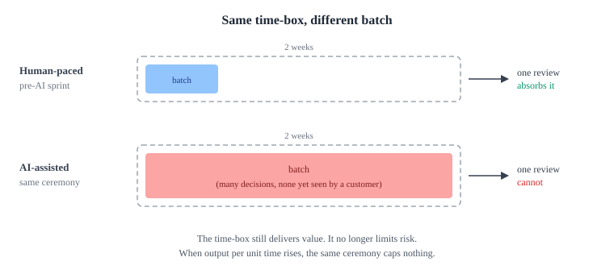
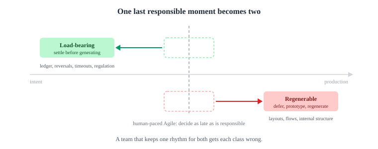
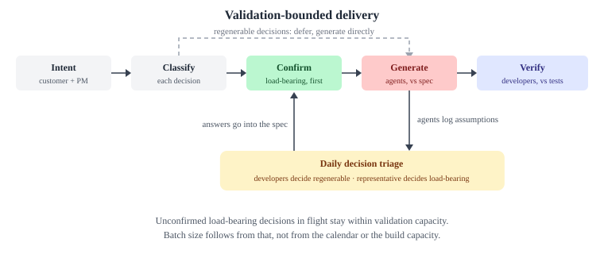

A team can now build in days what the business needs weeks to confirm. The sprint still ends on Friday, the demo still runs, and every signal says the work is done. Whether it is the *right* work is a question the process no longer has time to answer.

That is a new problem, and to see why, it helps to remember what Agile was for in the first place.

Agile was an answer to a hard question: **what do you do when you cannot know what to build until you have built some of it?**

The answer before Agile was to try harder at knowing. Barry Boehm's work showed that a defect found late can cost far more to fix than the same defect found early [[1]](#ref-1), so the rational response was to specify as much as possible before building. That is the logic of Waterfall, and it was not stupid. Its weakness was the assumption that enough upfront effort could produce certainty about what customers needed. It usually could not.

Agile's answer was different. Kent Beck argued that with test-driven development, continuous integration and refactoring, the cost of change could be flattened enough that deferring decisions stopped being reckless [[2]](#ref-2). Mary and Tom Poppendieck gave the idea its best name: make each decision at the *last responsible moment* [[3]](#ref-3). Plan a little, build a little, show it to the customer, learn, adjust.

That answer was a trade-off between two costs. One was the **cost of building**: every increment took real developer time, so you could not afford to build many versions of anything. The other was the **cost of being wrong**: the further you went on a mistaken assumption, the more you had to throw away. Short iterations balanced the two. Build enough to learn something; not so much that being wrong is ruinous.

AI has changed one side of that trade-off dramatically. Building is far cheaper than it was. The cost of being wrong has not moved in the same way. When one side of a balanced trade-off changes, the balance point moves. The question for anyone running software delivery is where it moves to, and whether our processes have noticed.

My answer is that it moves in two directions at once. Before getting there, it is worth looking at what happens when a team does not notice at all.

---

## The hollow sprint

When I learned Scrum, the purpose of a sprint was to produce a shippable outcome frequently. The 2017 Scrum Guide said exactly that: "the purpose of each Sprint is to deliver Increments of potentially releasable functionality." [[4]](#ref-4) The 2020 edition kept the idea, requiring the increment to be usable, and added a second purpose that is easy to miss: "Shorter Sprints can be employed to generate more learning cycles and limit risk of cost and effort to a smaller time frame." [[5]](#ref-5)

So the sprint has two jobs. It turns ideas into usable value, and it **limits risk** by capping how much gets built before the next chance to learn whether it was the right thing. For twenty years these jobs moved together. Two weeks of human effort produced an increment small enough for a review to absorb. Don Reinertsen's work on product development flow explains why that size mattered: the more work built between two feedback points, the more assumptions ride on each one, and the more rework a wrong assumption causes [[6]](#ref-6).

AI separates the two jobs. The first gets easier: usable increments arrive faster than ever. The second quietly fails, because the time-box only limited risk while human output limited the batch. Put another way, the sprint used to control two capacities at once: how much the team could build, and how many decisions the business could absorb. As long as the first was the smaller of the two, controlling it controlled both. **AI has made build capacity and decision capacity diverge.**

  

I call the result **the hollow sprint**: a sprint that still delivers a usable increment on schedule, with every ceremony intact, while the amount of unconfirmed work inside it has grown beyond what one feedback point can check.

What makes it dangerous is that it reports success. The Scrum Guide never defines a failed sprint. The Sprint Goal is set by the team, the Definition of Done is a quality standard the team holds itself to, and the guide is explicit that "the Sprint Review should never be considered a gate to releasing value." [[5]](#ref-5) None of that was a flaw when building was slow, because the customer saw everything soon anyway. With AI, generated code meets the Sprint Goal, passes the tests and satisfies Done. Every official signal says the sprint went well. Nobody outside the team has confirmed anything.

I argued in [The Evaluation Constraint](/systems/culture/scale/2026/08/02/the-evaluation-constraint/) that AI made trying things cheap and left knowing whether they worked expensive, and in [The Cognitive Load Ceiling](/systems/scale/2026/03/23/cognitive-load-ceiling/) that it can produce software faster than a team can understand it. The hollow sprint is what that looks like inside a delivery process: the knowing falls behind, and the process has no alarm that rings when it does.

One caution. The throughput gain is not universal. A 2025 randomized trial by METR found experienced developers working in mature codebases they knew well were *slower* with AI tools, even though they believed they were faster [[7]](#ref-7). Integration-heavy, regulated systems, the kind I work on, are where gains are smallest. The argument does not need AI to make everyone faster. It needs only this: **wherever throughput has jumped, the time-box has stopped limiting risk.** You can check that in your own team by comparing how much changed between your last two sprint reviews with the same comparison two years ago.

---

## The fork

So the old balance is broken. Where does the new one sit? There are two credible answers, and they point in opposite directions.

**Scenario A: plan more.** If implementation is cheap, the time spent defining requirements no longer competes so directly with building. Three days sharpening a specification used to cost three days of development; now it costs a small fraction of what it would take to generate, integrate and unwind the wrong system. Meanwhile, every wrong assumption gets built on faster, by agents that do not stop to ask. On this reading, the economically rational move is toward more upfront definition: settle requirements, interfaces and constraints before generating anything large. Practitioners already have a name for the shape this produces. In 2011 Dave West of Forrester called it *Water-Scrum-Fall*: upfront planning and downstream release gates wrapped around a Scrum middle [[8]](#ref-8). It was meant as a criticism. AI makes it look like a rational design.

**Scenario B: iterate more.** If implementation is cheap, so is a prototype. A team can show a customer three working versions of a workflow in the time it once took to write one requirements document. Why spend days specifying what the customer wants when you can generate something and watch them react to it? If prototypes become nearly free, iteration itself becomes cheaper, and the rational move is to build more and earlier, and plan less.

Both arguments are sound, and both have evidence on their side. Scenario A matches what happens when teams generate large amounts of code on a misunderstood requirement. Scenario B matches what happens when product teams use prototypes to settle questions in an afternoon that used to take a sprint.

They cannot both be the right default. But they can both be right.

---

## It depends on the decision

The fork dissolves once you stop asking it about the project as a whole and ask it about each decision inside the project. The missing variable is not the size of the project or the maturity of the team. It is one property of each decision: **what happens when you reverse it.**

> **A regenerable decision is one whose reversal is contained. A load-bearing decision is one whose reversal invalidates the decisions built on top of it.**

**Regenerable decisions** include screen layouts, the order of steps in a form, wording, dashboards, internal module structure, an implementation choice behind a stable interface. Being wrong means regenerating one piece. For these, Scenario B is usually the better default: build, show, learn, regenerate. Their last responsible moment moves *later* than Agile ever allowed, because changing them is now almost free.

**Load-bearing decisions** are the ones everything else comes to depend on. In payments they are easy to name: what counts as a completed transaction; what happens when the switch times out after a debit has posted; how a late reversal settles; what is written to the ledger before a notification is sent; which regulatory controls apply. For these, Scenario A is usually the better default. Their last responsible moment moves *earlier*, to before the generation that depends on them, because AI builds on top of them so quickly.

A small example shows the difference. Suppose an agent builds a wallet's reversal flow on the assumption that a timeout means the original debit failed. The screen that tells the customer "your payment did not go through" can be regenerated in minutes. But if the same assumption has already shaped the ledger entries, the reconciliation job, the notification logic and the settlement file, then correcting it is not a small change. The bank may in fact have completed the debit, and every component built on the opposite premise now disagrees with the bank. The code may be cheap to rewrite. **The decision graph is not.**

  

This is the core of the argument. **AI did not settle the debate between planning and iterating. It split it in two.** The single "last responsible moment" that Agile applied to every decision has become two moments moving in opposite directions. A team that keeps one rhythm for everything gets both wrong: it over-plans the regenerable work, wasting the cheapest thing it has, and under-plans the load-bearing work, letting agents build fast on premises nobody has confirmed. AI scales up whatever the team misunderstands between feedback points, and it does so most expensively on the decisions that carry weight.

The two-line version is something a team can carry into its next planning session:

- **Contained reversal: defer and iterate.**
- **Cascading reversal: decide earlier.**

In practice this is a spectrum rather than two clean boxes, and where a decision falls is itself a judgment call that can be wrong. A UI choice becomes load-bearing once an integration partner depends on it; a ledger detail can be contained if it sits behind a well-defined interface. Even so, "what happens if we reverse this?" is a far more useful question than "Agile or Waterfall?", because it can be asked about each decision on its own, today, by people who know the domain.

### Decide earlier does not mean specify upfront

There is an obvious objection here: isn't "decide load-bearing decisions earlier" just Waterfall for the important parts? It would be, if deciding earlier meant writing a long requirements document. It does not have to.

Reversal cost tells you *when* a decision must be settled. Two other questions tell you *how*:

- **How uncertain is the decision?** Some load-bearing decisions are well understood. Whether transaction state is authoritative in the wallet service or in the payment switch is consequential, but an experienced team can usually settle it in a design conversation and record it. Others are genuinely open. Whether to support one settlement model or three is just as load-bearing, but nobody knows the answer from a meeting room.
- **How cheaply can the uncertainty be resolved?** For the open questions, the right response is rarely a three-week requirements phase. It is often a few thin, throwaway models or prototypes, built in days, shown to the people who know the business, and discarded once the decision is made.

So the full rule has three parts: reversal cost sets the deadline, uncertainty sets the effort, and the cheapest way to resolve that uncertainty sets the method. Important, uncertain decisions get resolved deliberately *before* downstream generation, and that resolution can itself be thoroughly iterative. What changes is not whether a team iterates, but what it iterates on: the decision first, then the system built on it.

It also explains why neither camp's evidence is wrong. The teams who say AI makes them more Agile are mostly prototyping regenerable things. The teams who find themselves drifting toward upfront specification are mostly building systems where the expensive decisions are load-bearing. Fintech, healthcare and anything regulated sits heavily in the second group.

---

## What this does to Agile's commitments

Agile's manifesto is short, and only part of it speaks to the balance between planning and iterating [[9]](#ref-9). Two of its values change in specific ways once decisions are split.

**"Responding to change over following a plan"** is stronger than ever for regenerable decisions, where change is nearly free. For load-bearing decisions something subtler happens. The fastest way to change a generated system is no longer to edit its code but to edit its specification and regenerate. Responding to change increasingly *means* changing the plan; the plan stops being what change fights against and becomes the medium change travels through. **"Working software over comprehensive documentation"** shifts in the same way. The rejection of documents written to satisfy process still holds, but a precise statement of load-bearing rules is no longer a description of software someone will write later. It is the input software is generated from. I wrote about the engineering side of this in [Why Architecture Is Shifting From Diagrams to Guardrails](/systems/architecture/scale/2026/05/09/rewrite-preconditions/); the same shift applies to business rules.

The principles behind the manifesto follow the same split [[10]](#ref-10). Welcoming late changes, letting designs emerge, and treating working software as the measure of progress all remain sound for regenerable decisions. For load-bearing ones they need a qualifier: late change means unwinding generated work, emergent design means inheriting whatever each generation step assumed, and running software proves little when it can run perfectly while encoding the wrong settlement model. None of this makes the manifesto obsolete. It treated every decision as one class, because at human pace there was no reason not to.

---

## The customer side

If load-bearing decisions have to be confirmed before generation, someone has to confirm them. In most organizations that is the part of the system with the least spare capacity: the customer, the product owner, the domain expert, the compliance reviewer. Making Agile work in the AI era is mostly about this side of the table, and it is the part engineering leaders most often leave to chance.

**Know your validation capacity.** Every organization has a finite number of customers, product owners, domain experts and compliance reviewers able to confirm load-bearing decisions carefully. AI can multiply generation capacity far faster than it can multiply those people. Little's Law, one of the sturdiest results in operations research, says that in a stable system the number of items waiting equals their arrival rate multiplied by how long each waits [[11]](#ref-11). If agents produce load-bearing decisions faster than they are confirmed, the queue grows and so does the wait. Faster generation does not shorten that wait; it lengthens it. So plan against validation capacity, not against the team's build capacity and not against the calendar: unconfirmed load-bearing decisions in flight should not exceed what the business can confirm.

**Wire customer confirmation into the stop signal.** The hollow sprint survives because every signal that ends a cycle is judged by the team. Each method has a place to change that without abandoning the method. In Scrum, state the Sprint Goal as a confirmed outcome rather than an output, and add a line to the Definition of Done: every load-bearing decision in this increment has been confirmed by the Product Owner or customer. In Kanban, which has no sprints but limits work in progress [[12]](#ref-12), add an explicit "awaiting confirmation" stage with its limit set to the business's validation capacity, and keep items small enough that each carries only one or two load-bearing decisions. In XP, keep customer-owned acceptance tests as the definition of done, and keep the agents from writing the tests they are checked against.

**Run a daily decision loop.** Instruct agents to record the assumptions they make, not only the code they write. Each day, developers sort the log: regenerable assumptions they decide themselves; load-bearing ones go to a business representative in a short, fixed slot, and the answers go back into the specification so the same question is never asked twice. This is XP's On-Site Customer, given a sharper job [[2]](#ref-2). It also carries XP's warning: when Angela Martin, Robert Biddle and James Noble studied the customer role on real projects, they found it so demanding that representatives were overloaded and the role was hard to sustain [[13]](#ref-13). Agents ask more questions than developers did. The loop works only if the representative has the authority to decide without escalating, protected time that is part of the job rather than on top of it, and a triage step that shows them only load-bearing questions.

**Spend prototypes where uncertainty is high.** As the rule above implies, Scenario B is right for regenerable decisions, and it is also often the best way to resolve an uncertain load-bearing one: a new workflow, a pricing or settlement model, an onboarding journey. Have the product manager build the visible part with the customer in the room, keep the confirmed decisions, and throw the prototype away. But every prototype spends customer attention, so it draws on the same validation capacity.

  

**Measure the constraint that matters.** Velocity and story points measure building capacity. In AI-assisted teams where that capacity has expanded sharply, it may no longer be the constraint that matters most. The most important measure is **decision latency**: the time from an assumption being logged to it being confirmed or corrected by someone with business authority. If it is rising while the ceremonies stay the same, the process is no longer agile in any meaningful sense, whatever it is called. Two more measures support it: **unconfirmed load-bearing decisions in flight**, which should stay within validation capacity; and **rework from overturned assumptions**, the generated work thrown away because an unconfirmed premise turned out wrong. That last one is the direct cost of a hollow sprint, and it usually goes unseen because regeneration makes it feel cheap.

None of these practices is new. Customer acceptance tests, on-site customers, work-in-progress limits and queueing theory all predate this wave of AI. What is new is the reason to take them seriously. For twenty years they were optional, because slow building did their job for free.

---

## The decision is the unit

So is Waterfall coming back? Not as a methodology. What is going away is the idea that a whole project needs a single delivery philosophy.

A single payments project can now contain Waterfall-like treatment for transaction semantics, ledger behaviour, settlement, data ownership, security boundaries and regulatory rules, and thoroughly Agile treatment for screens, workflows, copy, dashboards and internal implementation, all at the same time. The question "are we an Agile shop or a Waterfall shop?" stops being useful. **The unit of methodology is no longer the project or the feature. It is the decision.** The answer to the hollow sprint is not to return to Waterfall. It is to stop treating every decision as if it had the same reversal economics.

That also changes what a CTO should watch. When AI raises build throughput, the constraint moves to the next thing in line, and in most organizations that is the rate at which the business can confirm the decisions embedded in the work. Decision latency is the measure of that constraint, which makes it, not velocity, the number that tells you whether your delivery process is keeping up.

I should be clear about what this post is. It is an argument, not a measured result. I have not seen the daily decision loop or these measures tested at scale, and the measures above are how you would find out whether they work in your organization. The real cost also falls where engineering leaders have least control: on the business side, which has to give daily, protected time to confirming decisions. If an organization cannot provide that, the honest fallback is the unpopular one: deliberately build less per cycle than the team is capable of, so the batch stays within what the customer can absorb.

For a CTO, the questions are short:

- Which decisions in your current roadmap are load-bearing, and have they been confirmed by someone with business authority?
- When your process says the work is done, who decided that: the team, or the customer?
- How long does a load-bearing decision wait before it is confirmed, and is that wait growing?
- Are your sprint boundaries still controlling risk, or only the calendar?

Agile taught us to delay each decision until the last responsible moment. AI has not made that principle obsolete. It has made us ask, for every decision, when that moment actually is.

The future of software delivery may not be Agile or Waterfall. It may be knowing which decisions deserve each.

---

## Sources

[1] Barry W. Boehm, *Software Engineering Economics* (Prentice Hall, 1981).

[2] Kent Beck, *Extreme Programming Explained: Embrace Change* (Addison-Wesley, 1999).

[3] Mary Poppendieck and Tom Poppendieck, *Lean Software Development: An Agile Toolkit* (Addison-Wesley, 2003).

[4] Ken Schwaber and Jeff Sutherland, *The Scrum Guide* (November 2017), section on the Sprint.

[5] Ken Schwaber and Jeff Sutherland, *The Scrum Guide* (November 2020), sections on the Sprint, Sprint Goal, Sprint Review and Definition of Done. [scrumguides.org](https://scrumguides.org/scrum-guide.html)

[6] Donald G. Reinertsen, *The Principles of Product Development Flow: Second Generation Lean Product Development* (Celeritas, 2009).

[7] METR, "Measuring the Impact of Early-2025 AI on Experienced Open-Source Developer Productivity" (July 2025). [metr.org](https://metr.org/blog/2025-07-10-early-2025-ai-experienced-os-dev-study/)

[8] Dave West, "Water-Scrum-Fall Is The Reality Of Agile For Most Organizations Today," Forrester Research (2011).

[9] Kent Beck et al., *Manifesto for Agile Software Development* (2001). [agilemanifesto.org](https://agilemanifesto.org/)

[10] Kent Beck et al., *Principles behind the Agile Manifesto* (2001). [agilemanifesto.org/principles.html](https://agilemanifesto.org/principles.html)

[11] John D. C. Little, "A Proof for the Queuing Formula: L = λW," *Operations Research* 9, no. 3 (1961): 383–387.

[12] *The Kanban Guide*, sections on WIP and flow. [kanbanguides.org](https://kanbanguides.org/english/)

[13] Angela Martin, Robert Biddle and James Noble, "The XP Customer Role in Practice: Three Studies," *Proceedings of the Agile Development Conference* (2004).
