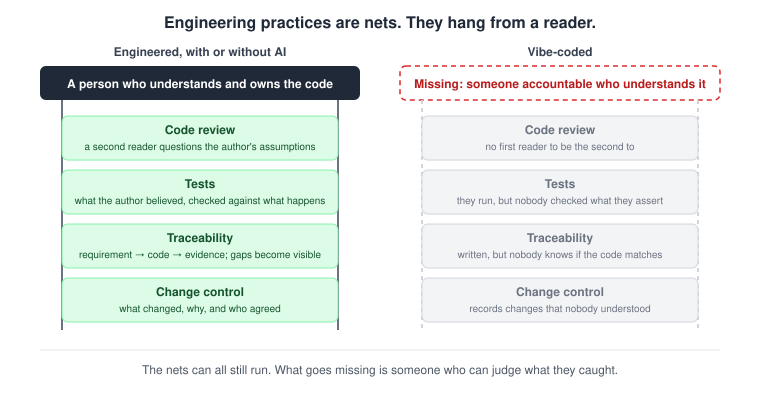
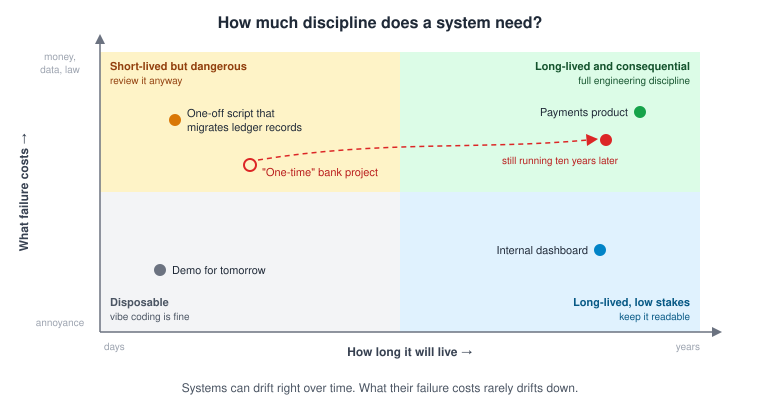
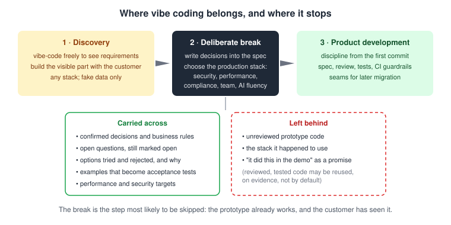
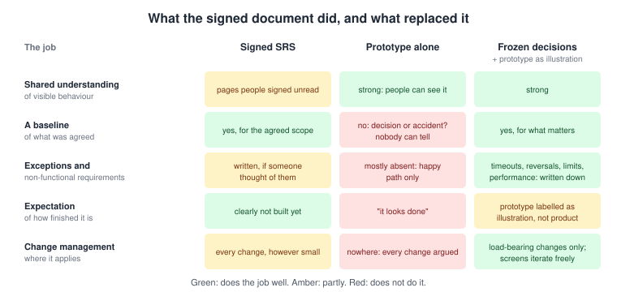
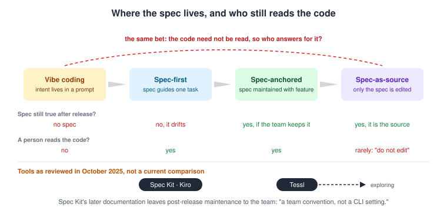

I gave a guest lecture this week on software requirements and design: what happens to the SRS and the SDS when AI agents write much of the code. We covered specifications, architecture decision records, C4 diagrams and automated guardrails. Somewhere in the middle I realised I had skipped something more basic. I had presented spec-driven development as the natural way to work with agents, and never stopped to compare it with the way many people actually work with them today: describe what you want, accept what comes back, and keep going until it runs.

Thinking about that gap afterwards, I found the real question was not about tools at all. It was about what we mean by *engineering*. This post is my attempt to think it through. It is an opinion, not advice, and I hold it loosely.

---

## A requirement rather than a reality

The phrase *software engineering* is younger than many of the people who use it. It was popularised at a NATO conference in Garmisch, Germany, in October 1968, called because large software projects kept arriving late, over budget and unreliable. Some of the participants were willing to call it a "software crisis."

Brian Randell, who was there and co-edited the conference report, looked back fifty years later. The title, he wrote, had been chosen deliberately to be provocative, "describing a requirement rather than a reality," and he credits the choice to Fritz Bauer [[1]](#ref-1).

I find that phrase humbling. Engineering discipline was never something software simply had. It was something the field decided it needed, because too much was falling through the cracks. Testing and design reviews already existed in some form, but requirements engineering, systematic reviews, configuration management and change control became, over the following decades, the field's way of trying to make that aspiration real.

That is the lens I want to use for vibe coding. The question is not whether AI is good or bad for software. It is whether a new way of working keeps the aspiration, or quietly drops it.

---

## What the discipline is actually for

"Discipline" can sound like a virtue word, so it is worth being concrete about what it does.

Most of the practices we call engineering exist for one reason: **to catch what a single person's attention misses.** Each one is a net. None is perfect, but together they mean that a mistake has to slip through several independent checks before it reaches production.

There is a long-standing reason these nets matter so much. Robert Glass collected the evidence decades ago: historically, maintenance has consumed 40 to 80 percent of software costs, about 60 percent on average, and the single largest maintenance activity is simply understanding the existing code [[2]](#ref-2). Manny Lehman's first law of software evolution adds that software used in the real world must keep changing or become progressively less useful [[3]](#ref-3). Software is read and changed far more than it is written. The discipline exists largely for those later readers.

---

## What vibe coding removes

The term *vibe coding* comes from Andrej Karpathy, who described in February 2025 "a new kind of coding … where you fully give in to the vibes, embrace exponentials, and forget that the code even exists" [[4]](#ref-4). He was clear about where it belonged: "not too bad for throwaway weekend projects."

Simon Willison gave the clearest definition I have found: vibe coding is "building software with an LLM without reviewing the code it writes" [[5]](#ref-5). He is equally clear about what it is not. If an LLM wrote every line but you reviewed it, tested it and can explain it to someone else, that is not vibe coding; it is software development. His own rule is that he will not commit code he could not explain to somebody else. Martin Fowler draws the same line [[6]](#ref-6).

This is why I think the usual framing, "AI coding versus traditional coding," misses the point. Using AI heavily is not the problem. Teams can and do use AI to write most of their code while keeping every net in place.

What vibe coding removes is more basic than any single practice. Code review assumes there is an author who understood the code, and adds a second reader. Vibe coding removes the *first* reader: not the model, which has certainly processed the code, but the person who can explain what it does, question its assumptions and take responsibility for its behaviour. Tests can still run, but unless someone has checked what they assert against the actual requirements, they may faithfully verify the wrong interpretation. The nets are still hanging there, but the person they were tied to is gone.

I should be fair to the strongest objection here. Reading every line by hand is not the only way to gain confidence in software. Behavioural and property-based tests, static analysis, independent review, observability and staged releases all produce evidence about whether a system works, and a team can lean on them heavily. I agree. But evidence still needs someone to judge it: someone who understands the system well enough to know whether the tests check the right things, and who has the authority to say the business rule itself is right. Those are not always the same person; an engineer may understand the code perfectly without being able to confirm the rule, and a product owner may own the rule without being able to read the code. What I am really arguing for is not line-by-line reading. It is that, for anything that matters, someone accountable has understood what was built and the evidence that it works.

---

## How much discipline does a system need?

None of this means every line of code deserves full ceremony. A demo for tomorrow's meeting does not need traceability or change control. Discipline has a real cost, and spending it where nothing can fall far is waste.

My instinct is that the amount of discipline a system needs depends on two things: **how long it will live**, and **what it touches**, which is really a question of what happens if it fails. A script that runs once sounds disposable, until it is the script that migrates a bank's ledger records.

How long it lives is where the difference between project companies and product companies comes in. A project delivered once might survive vibe coding, and the speed might genuinely help it win. A product shipped release after release for years is read and changed by people who did not write it, which is exactly where Glass's numbers bite.

Even here, though, I have learned to be careful:

- **Few projects are as one-time as they look.** Warranty periods, change requests and maintenance contracts mean that a system built as a project for a bank can still be running a decade later.
- **In a project, the cost does not disappear; it moves.** The team that delivered moves on, and whoever maintains the system next, often the client's own team, inherits code that nobody ever read.
- **It may close the road from project to product.** In [*The Inevitable Cycles*](https://aathawerani.github.io/systems/culture/scale/2026/01/12/software-house-evolution/) I described how software houses usually become product companies: similar projects repeat, teams notice common components, and reuse gradually becomes a product [[7]](#ref-7). That depends on someone understanding the projects well enough to see what they share. If nobody read the code, there is nothing to harvest.

What the system touches is the second dimension, and it is where my own field sits at the extreme.

---

## In fintech, the discipline is written down

In payments, "nothing falls through the cracks" is not a figure of speech. A crack is a debit with no matching credit, a reversal applied twice, a transaction the ledger says failed while the bank says it succeeded. In [*The Hollow Sprint*](https://aathawerani.github.io/systems/culture/scale/2026/10/09/the-hollow-sprint/) I used the example of a wallet that assumes a switch timeout means the debit failed: once that assumption has shaped the ledger, the reconciliation job, the customer notification and the settlement file, correcting it is no longer a small change [[8]](#ref-8). Those are exactly the cases the engineering nets exist to catch, and exactly the cases that only appear when someone thinks carefully about what can go wrong.

In this domain the discipline is also not left to taste. Take the card industry's security standard. PCI DSS version 4.0.1 requires that bespoke and custom software is reviewed before it is released to production, to find and correct coding vulnerabilities (Requirement 6.2.3). Where those reviews are manual, code changes must be "reviewed by individuals other than the originating code author" and approved by management before release (Requirement 6.2.3.1) [[9]](#ref-9).

I want to be careful about what the standard does and does not say. It does not prescribe how much code a person must write, and it does not say the originating author must have written or understood every line. Its concern is that software is reviewed before release and, where reviews are manual, that the review is independent and approved. Whether a vibe-coded module can pass an audit depends on how a particular organisation implements its controls.

My concern is the one underneath. When most of an implementation is generated, who can explain its assumptions, judge whether the review was meaningful, and take responsibility for the result? Complying with a review requirement and genuinely understanding the code are related, but they are not the same thing. Still, the direction of the standard is clear: in fintech, the 1968 aspiration has become, at least in places, a written obligation.

---

## Where vibe coding belongs

None of this makes vibe coding useless. I think it has a proper place, and it is at the very beginning.

Customers are often much better at reacting to something they can see than at describing what they want. Requirements engineering has known this for a long time: Karl Wiegers and Joy Beatty distinguish *throwaway* prototypes, built to learn and then discarded, from *evolutionary* prototypes that grow into the product [[10]](#ref-10). Fred Brooks put the older version more bluntly: "plan to throw one away; you will, anyhow" [[11]](#ref-11). What vibe coding changes is the cost. A throwaway prototype that once took weeks can now be produced in an afternoon, with the customer in the room. In [*The Hollow Sprint*](https://aathawerani.github.io/systems/culture/scale/2026/10/09/the-hollow-sprint/) I suggested exactly this for uncertain decisions: build the visible part with the customer, keep the confirmed decisions, and throw the prototype away [[8]](#ref-8).

The important words there are *throw the prototype away*. What should survive a vibe-coded prototype is not its code but the decisions it helped people make, written down where they can be checked.

This is also where my earlier post on [technology stack selection](https://aathawerani.github.io/systems/scale/2026/05/27/tech-stack-ai-agents/) comes back in, with a caveat against myself [[12]](#ref-12). In that post I argued that starting in a stack where AI tools are strongest is sensible, and that a product can later move parts of itself to the stack its domain demands, as fintech cores often drift towards ecosystems with stronger compliance tooling. But I also wrote that "the prototype built with speed but no structural discipline tends to become the thing that blocks future progress — not because it failed, but because it succeeded." Those later migrations only stay small because the prototype had clean seams from the first day: domain modules, one interface file per external service, an architecture file the agent reads.

A vibe-coded prototype has none of those seams. That is fine if it really is thrown away. The danger is the prototype that impresses the customer and quietly becomes version one. Then nobody ever chose the stack deliberately, and there is no clean seam to migrate along.

So the shape I keep coming back to has three phases: vibe-coded discovery, a deliberate break, and disciplined product development.

Two details matter. In fintech, discovery should use fake data only; a prototype holding real customer or card data inherits the product's obligations. And "throw it away" is a default, not a rule: code that has genuinely been reviewed and tested to production standards can be reused on that evidence. What should not cross the break is code nobody has read, simply because it already works.

---

## The signed document we gave up

That brings me to something I talked about in the lecture without having planned to.

For most of my career, a project began with a detailed functional specification or SRS. The customer read it, argued over it and signed it. It was not only a technical document. It was the scope of a commercial agreement: the price was attached to it, and any change after signature went through a change management process, with an impact assessment and, often, a revised cost. Wiegers and Beatty describe this as the requirements baseline, the agreed set against which every later change is evaluated [[10]](#ref-10).

That document was far from perfect. Customers signed pages they had not fully understood, and the gap between what they read and what they later saw on screen was a constant source of change requests. Agile was partly a reaction to exactly this.

Vibe coding has made much of that document feel unnecessary. For visible behaviour, a customer who can click through a working prototype understands what is being built far better than one who reads two hundred pages of "the system shall." But a prototype does not by itself establish what has been agreed, what remains undecided, or what the system must do when things go wrong. It is a discovery tool, not a requirements baseline.

The signed document did at least two jobs the prototype does not.

**It was a baseline.** It said what had been agreed, so that a change could be recognised as a change. A prototype does not separate what was agreed from what the model happened to generate. When the customer later says "but it did this in the demo," it is hard to say whether that behaviour was a decision or an accident.

**It covered what screens do not show.** A prototype shows the happy path beautifully. It is mostly silent on what happens when the switch times out, when a reversal arrives late, when a limit is breached, or how fast the system must respond under load. In payments, those are precisely the things that turn into disputes.

And there is a third problem the old document never had. A customer who has clicked through something that looks finished tends to believe it nearly is. The prototype becomes the product in their mind, and sometimes in the plan, which is the failure from the previous section arriving through the commercial door rather than the technical one.

All of this makes requirements much harder to freeze. When the next version is one prompt away, every meeting can produce a new idea, and without a baseline every change request becomes a negotiation.

---

## Freezing what can be frozen

I do not think the answer is to go back to two-hundred-page specifications. I think it is to be selective about what we freeze.

In *The Hollow Sprint* I separated two kinds of decision [[8]](#ref-8). **Regenerable** decisions, such as screen layouts, wording or the order of steps in a form, are cheap to reverse; being wrong means regenerating one piece. **Load-bearing** decisions are the ones everything else comes to depend on: what counts as a completed transaction, how a reversal settles, what is written to the ledger, which limits and controls apply, what the integration contracts with the bank or switch look like, and the performance and security requirements the system must meet.

That distinction suggests a different shape for the agreement:

- **Freeze the load-bearing decisions.** Write them down precisely, have the customer confirm them, baseline them, and put them under change management. This is a much shorter document than the old SRS, but each line in it matters.
- **Let the regenerable decisions stay open.** Iterate on them with the customer using the prototype, which becomes an illustration of intent rather than the contract itself.
- **Apply change management where change is expensive.** A new screen layout should not need an impact assessment. A change to how reversals settle always should.

I have not seen many contracts written this way yet, and I am not sure how pricing should work when part of the scope is deliberately left open. That feels like an unsolved problem for project companies in particular. One possibility I would like to explore is to fix the price and acceptance criteria for the load-bearing decisions, and treat the visible experience as iterative scope within an agreed time budget. The contract would then protect what must not change without pretending every screen is known in advance. I offer that as an idea, not as something I have seen proven. But it seems closer to the truth than either extreme: a signed document that pretends everything is known, or a prototype that pretends nothing needs to be.

---

## What spec-driven development looks like today

Those frozen, load-bearing decisions have to live somewhere, and spec-driven development is the obvious candidate. Before arguing about whether it is the answer, it is worth looking at what the term currently means in practice, because it is younger than it sounds. Most of the tooling appeared in the second half of 2025. Three tools come up most often, and Birgitta Böckeler's hands-on review of them on martinfowler.com is the most careful comparison I have found [[13]](#ref-13).

**GitHub Spec Kit** is an open-source, MIT-licensed toolkit that sets up a repository so that a coding agent works through a fixed sequence [[14]](#ref-14). A project starts with a `constitution.md` of principles that apply to every change. Each feature then moves through *specify*, *plan*, *tasks* and *implement*, producing a `spec.md`, a `plan.md` and a `tasks.md`. The current documentation adds an *analyze* step that reports gaps between those artifacts and a *converge* step that checks the implementation against them. The philosophy is stated bluntly in the project's methodology document: "Specifications don't serve code—code serves specifications" [[15]](#ref-15). The project began in August 2025 and reached version 1.0.0 in August 2026, by which point its documentation listed 38 coding-agent integrations [[14]](#ref-14).

**Kiro** is Amazon's agentic development environment, built on VS Code and launched in July 2025 [[16]](#ref-16). Its pitch was explicitly framed against vibe coding: to combine "the flow of vibe coding" with "the clarity of specs." A Kiro spec is three files: `requirements.md`, written as user stories with acceptance criteria in EARS notation ("WHEN [condition or event] THE SYSTEM SHALL [expected behaviour]"), `design.md` for architecture and sequence diagrams, and `tasks.md` for the implementation plan [[17]](#ref-17). Alongside specs, Kiro has *steering* files that describe the product, technology and structure, and *hooks*, event-driven automations that run an agent when something changes, such as updating a test file when a component is saved [[16]](#ref-16).

**Tessl** is the most ambitious of the three and, when Böckeler reviewed it, still in private beta [[13]](#ref-13). Specifications live in `*.spec.md` files, each currently mapped to one code file, and the generated code carries a header comment telling people not to edit it: `// GENERATED FROM SPEC - DO NOT EDIT`. Of the three, it is the one that openly aims beyond the first release.

Böckeler offers a useful way to place them. She distinguishes three levels of spec-driven development: *spec-first*, where a specification guides the task in hand; *spec-anchored*, where it is maintained as the feature evolves; and *spec-as-source*, where people edit only the specification and never touch the generated code [[13]](#ref-13). Putting vibe coding at the start of the same scale makes something visible that the prose hides.

Her experience with the tools in October 2025 was mixed, and I think her caveats matter as much as the features. Kiro turned a small bug into four user stories with sixteen acceptance criteria. Spec Kit generated many verbose markdown files that she found more tedious to review than code, and its agent sometimes ignored notes about existing classes and created duplicates. Regenerating code from the same Tessl spec produced different results each time. Her review predates Spec Kit 1.0, so some of this may have moved on; I take it as a snapshot of where the tools were, not a ranking of where they are.

---

## A tool, not the discipline

What strikes me most is not any individual feature but where the tools stop.

A product does not just need a well-documented first release; it needs a specification that is still true at release ten. That is the spec-anchored level, and it is exactly the part the tools leave to people. Spec Kit's own documentation is admirably honest about this. It now names Böckeler's three levels itself, describes three ways a team might maintain its specs after delivery, and says plainly that none is the default: "The model is a team convention, not a CLI setting" [[18]](#ref-18). In other words, the tool can carry a specification to the first release. Whether it stays true afterwards is still a matter of discipline.

There is a subtler limit as well. A specification can make a wrong decision consistent and repeatable; it cannot make the decision right. If the reversal rule in the spec is wrong, the agent will implement it faithfully and the tests will confirm it faithfully. That still depends on domain knowledge and on the people with the authority to make the decision.

Spec-as-source makes me pause for a different reason. It asks people never to touch, and in practice never to read, the generated code. Structurally, that is the same bet vibe coding makes. Böckeler raises a related worry: that it may combine the rigidity of model-driven development with the non-determinism of language models [[13]](#ref-13). A careful specification in front of the bet is much better than nothing, but it does not bring back the reader.

And even a correct, current specification and well-understood code are not the whole story. Someone also has to be accountable once the system is live: for what happens when an assumption fails at month-end, when the bank changes its message format, or when reconciliation shows a difference nobody predicted. Understanding the code, owning the business rule and owning the system in production are three different responsibilities, and a healthy team knows who holds each.

So I have ended up thinking of spec-driven development as a very useful tool for carrying the discipline, not as the discipline itself. Whatever a team chooses, the discipline still has to live somewhere: in someone who understands the specification, the code, and the gap between them.

---

## Where I have landed, for now

If I had to put my current view in a few sentences:

- Software engineering began as an aspiration to stop things falling through the cracks, and most of its practices are nets that catch what one person misses.
- Using AI to write code does not abandon that aspiration. Removing the accountable human reader does.
- How much discipline a system needs depends on how long it lives and what its failure would cost; few systems are as short-lived as they first appear.
- In fintech, the discipline is partly written into standards, which makes code that nobody read hard to defend.
- Vibe coding belongs at the start, as a way of seeing requirements. What should survive it is the decisions, not the code.
- For visible behaviour, a prototype builds shared understanding better than a prose SRS, but it is not a baseline. Freeze the load-bearing decisions; let the regenerable ones stay open.
- Today's spec-driven tools, such as Spec Kit, Kiro and Tessl, are good at carrying a specification to the first release. Keeping it true afterwards, and understanding the code beneath it, is still left to people.

Randell's phrase has stayed with me since I first read it. Fifty-eight years on, software engineering is still in some ways a requirement rather than a reality. AI has made it far easier to produce software, and so it has also made it easier to forget the requirement. I do not think the answer is to produce less. I think it is to keep asking, for each piece of code, who has actually understood it.

I may well be wrong about parts of this. If you have seen vibe-coded systems hold up well over years of change, or disciplined teams where the nets failed anyway, I would genuinely like to hear about it.

---

## Sources

[1] Brian Randell, "Fifty Years of Software Engineering, or The View from Garmisch," keynote at ICSE 2018 (May 2018). [arXiv:1805.02742](https://arxiv.org/abs/1805.02742)

[2] Robert L. Glass, *Facts and Fallacies of Software Engineering* (Addison-Wesley, 2002), Facts 41 and 44.

[3] M. M. Lehman, "Programs, Life Cycles, and Laws of Software Evolution," *Proceedings of the IEEE* 68, no. 9 (1980).

[4] Andrej Karpathy, post on X (2 February 2025). [x.com](https://x.com/karpathy/status/1886192184808149383)

[5] Simon Willison, "Not all AI-assisted programming is vibe coding (but vibe coding rocks)" (19 March 2025). [simonwillison.net](https://simonwillison.net/2025/Mar/19/vibe-coding/)

[6] Martin Fowler, "Vibe Coding," martinfowler.com bliki. [martinfowler.com](https://martinfowler.com/bliki/VibeCoding.html)

[7] Ali Ahmed Thawerani, "The Inevitable Cycles: Why Software Houses Keep Returning to Square One," TECTONICS (January 2026). [aathawerani.github.io](https://aathawerani.github.io/systems/culture/scale/2026/01/12/software-house-evolution/)

[8] Ali Ahmed Thawerani, "The Hollow Sprint," TECTONICS (October 2026). [aathawerani.github.io](https://aathawerani.github.io/systems/culture/scale/2026/10/09/the-hollow-sprint/)

[9] PCI Security Standards Council, *Payment Card Industry Data Security Standard: Requirements and Testing Procedures*, version 4.0.1 (June 2024), Requirements 6.2.3 and 6.2.3.1. [PCI SSC Document Library](https://www.pcisecuritystandards.org/document_library/)

[10] Karl Wiegers and Joy Beatty, *Software Requirements*, 3rd ed. (Microsoft Press, 2013), chapters on prototyping and on requirements change management.

[11] Frederick P. Brooks Jr., *The Mythical Man-Month: Essays on Software Engineering* (Addison-Wesley, 1975), chapter 11, "Plan to Throw One Away."

[12] Ali Ahmed Thawerani, "Tech Stack Selection in the Age of AI Agents," TECTONICS (May 2026). [aathawerani.github.io](https://aathawerani.github.io/systems/scale/2026/05/27/tech-stack-ai-agents/)

[13] Birgitta Böckeler, "Understanding Spec-Driven-Development: Kiro, spec-kit, and Tessl," martinfowler.com (15 October 2025). [martinfowler.com](https://www.martinfowler.com/articles/exploring-gen-ai/sdd-3-tools.html)

[14] GitHub, *Spec Kit* repository, README and project history (accessed October 2026). [github.com/github/spec-kit](https://github.com/github/spec-kit)

[15] GitHub, "Spec-Driven Development," `spec-driven.md` in the Spec Kit repository. [github.com](https://github.com/github/spec-kit/blob/main/spec-driven.md)

[16] SD Times, "Amazon launches spec-driven AI IDE, Kiro" (14 July 2025). [sdtimes.com](https://sdtimes.com/ai/amazon-launches-spec-driven-ai-ide-kiro/)

[17] Kiro documentation, "Specs: concepts." [kiro.dev](https://kiro.dev/docs/specs/concepts)

[18] GitHub, "Spec Persistence Models," Spec Kit documentation (accessed October 2026). [github.com](https://github.com/github/spec-kit/blob/main/docs/concepts/spec-persistence.md)
