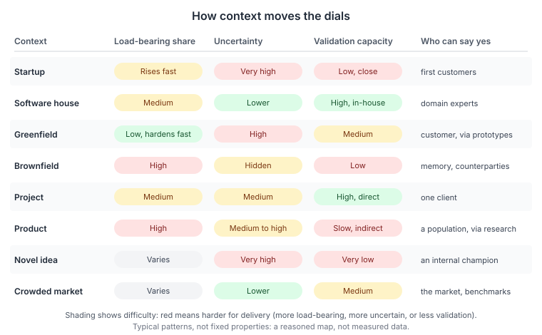
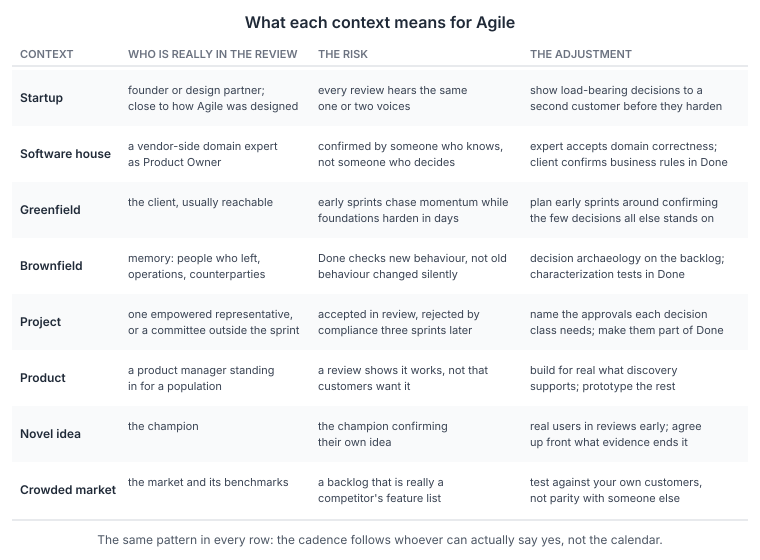
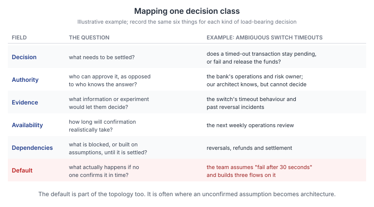

[The Hollow Sprint](/systems/culture/scale/2026/10/09/the-hollow-sprint/) ended on a claim: the unit of methodology is no longer the project. It is the decision. Decisions whose reversal is contained can be deferred and iterated. Decisions whose reversal cascades into everything built on top of them need to be settled earlier, and if they are genuinely uncertain, settled through cheap prototypes rather than long documents.

That post left a question open, and it is the one I find myself asking about my own work. *Which* decisions are load-bearing here? And who is supposed to confirm them?

A reader asked a version of the same question under my last post, [A Requirement Rather Than a Reality](/systems/culture/scale/2026/10/29/a-requirement-rather-than-a-reality/). If a prototype has replaced the signed specification, and decisions are agreed in demos and calls rather than on paper, who keeps the record of them, and who confirms it? My first answer was about documents. The more I thought about it, the more the documents looked like the easy part.

The answer clearly depends on context. A two-person startup and a fifty-person software house do not face the same decisions. Neither do a team rewriting a payments switch and a team building a new onboarding flow. The usual way to talk about that difference is with labels: startup or enterprise, product or project, greenfield or brownfield. Those labels are useful shorthand. But I have come to think they point at the wrong variable.

When building was expensive, the constraint that shaped delivery was mostly engineering capacity, so it made sense to describe context in terms of the team: how big, how mature, how much runway. Once AI makes building cheap, the constraint moves. It moves to the people who can confirm whether what was built is right. And that is where contexts really differ.

This post is an attempt to look at those differences through one question: **who can say yes?** It also asks what the answer means for Agile, whose ceremonies quietly assume one particular answer.

---

## Validation topology

The Hollow Sprint worked with three variables, which are easiest to think of as dials:

- **How much of the work is load-bearing**: the share of decisions whose reversal would cascade.
- **How uncertain those decisions are**: how much nobody yet knows.
- **How much validation capacity exists**: how many people can confirm load-bearing decisions, and how much of their time is available.

Context moves all three. But the third dial is more than a quantity. It has a shape. I will call that shape the **validation topology**: *where the people who can confirm load-bearing decisions sit, how many of them there are, how close they are to the work, and how much authority they carry.*

One distinction matters inside that definition. **Knowing is not the same as deciding.** A payments architect may know exactly how reversals behave in a particular switch and still have no authority to decide how a client’s settlement policy should work. A topology has people who can resolve questions about how the domain works, and people who own the business’s rules, risk appetite and regulatory obligations. Sometimes they are the same person. Often they are not, and the gap between them is where many decisions stall.

So a topology has several properties at once: who *knows*, who has the *authority* to decide, how *close* they are to the team's decision cycle, how *available* they are, and whether every kind of decision the work contains has someone who can confirm it. These are not a score to calculate; they are questions to ask about each class of decision. A team can be strong on one and weak on another. It can have an empowered business owner who answers within the hour, and nobody at all who can settle a question of regulatory interpretation.

And saying yes is not always approving an implementation. Sometimes it means confirming that an assumption holds, agreeing that a risk is acceptable, authorizing an experiment, or deciding that the evidence is not yet good enough to proceed. The question is who is entitled to make that call, whichever form it takes.

Two organizations can have the same number of people able to say yes and still behave completely differently. In one, the person who can confirm a settlement rule sits with the team and can answer by lunchtime. In the other, the confirmation has to come from a population of customers, through research and usage data, over weeks. The first can run something close to the daily decision loop described in the previous post. The second cannot, however disciplined it is.

These four panels illustrate shapes, not a classification of organizations; real teams usually combine more than one.

What I have come to think is that once AI has made building cheap, **the delivery model a team can sustain is set less by what kind of company it is than by its validation topology.** The labels still matter, but mostly because they are rough predictors of topology, and poor substitutes for knowing where decision authority, domain knowledge and validation capacity actually sit.

---

## A rule of thumb worth questioning

The rule of thumb I want to question is a familiar one: *Agile is for startups; structure is for enterprises.* Or its cousin: *choose your methodology by the type of company you are.*

I have written about the limits of this before. In [The Inevitable Cycles](/systems/culture/scale/2026/01/12/software-house-evolution/) I described how organizations swing between structure and flexibility and settle on hybrids. In [The CTO Decision Stack in Startup and Enterprise](/systems/culture/scale/2026/07/12/startup-enterprise-cto-decision-stack/) I suggested that the label was never the mechanism: a given constraint produces a given answer, whatever the company calls itself.

What AI adds is a change in *which* constraint dominates delivery. Speed versus rigour, runway versus reputation, still matter. But when a team can generate a sprint’s worth of work in days, the question that decides whether its process holds together is whether anyone can confirm the decisions inside that work at the rate it is produced. That depends on the topology, and the topology does not line up neatly with company type. A startup can have excellent validation access and a large enterprise terrible access, or the reverse.

The four contrasts below are the ones I find most useful. They are not four ways of classifying the same thing, and they are not boxes an organization fits into. They are four separate lenses on the same work, and one piece of work can sit in several at once. Each answers a different question about the topology:

| Contrast                      | What it helps explain                                                    |
|-------------------------------|--------------------------------------------------------------------------|
| Startup and software house    | Where domain knowledge comes from                                        |
| Greenfield and brownfield     | Whether the important decisions are new, or hidden in existing behaviour |
| Project and product           | Whether one customer can validate the outcome                            |
| Novel idea and crowded market | How much uncertainty existing evidence can resolve                       |

Each has its own way of failing when AI outruns the people who can say yes.

---

## The topology Agile assumes

Agile never ignored validation. It built a particular topology into its foundations. The manifesto asks that business people and developers work together daily throughout the project [[1]](#ref-1). XP put a real customer on the team. Scrum concentrates the role in one person: “The Product Owner is one person, not a committee,” and “for Product Owners to succeed, the entire organization must respect their decisions” [[2]](#ref-2). Agile’s feedback loop works best when that validator is close, available and authoritative: someone who can say yes.

That assumption was never fully true, and slower delivery did not make mistaken assumptions harmless. A wrong decision could still cause serious damage. But the time between building and feedback sometimes gave the people with real authority a chance to intervene before a mistake spread through much of the system. AI shortens that time, and what happens next depends on the topology.

This is where the two posts meet: **a hollow sprint is especially likely when the people validating an increment lack the authority to confirm its load-bearing decisions.** Sometimes that is because the Product Owner is a proxy. Often it is because no single role holds every kind of authority: a Product Owner may own product priorities and still have no say over regulatory interpretation, security or settlement rules. The sprint review looks like validation. Whether it is depends on who is in the room, and what they are entitled to decide.

A single table near the end gathers what each of these contexts means in Agile terms.

---

## Startups and established software houses

**Startups** have historically depended on Agile more than anyone. With little money, no product and no certainty about the market, the only rational strategy was to build a little, put it in front of a customer, and learn. Steve Blank formalized much of this as customer development: treat the business plan as a set of hypotheses and test them with real customers before scaling anything [[3]](#ref-3).

In a startup, the topology is usually small and close. One or two early customers, often design partners, can say yes. They are reachable, interested and willing to give feedback. Uncertainty is very high. Early on, most decisions are regenerable, because little has been built on top of them, although in fintech the moment real money or customer data starts flowing, the ledger and compliance decisions become load-bearing almost overnight.

The failure mode AI introduces here is subtle. A startup can now build an entire product around its first customer in a few weeks. That customer’s answers are real validation, but they are one organization’s answers. Before AI, building slowly meant the startup usually met its second and third customers before the product had hardened around the first. Now it can harden first. **The risk is not too little validation. It is validation from too few voices, built on too quickly.** The practical move is to treat the design partner’s yes as confirmation of their need, not the market’s, and to keep the decisions that only one customer has confirmed as regenerable for as long as possible.

**Established software houses** sit at the other end. Over years of client work, the good ones build something a startup often lacks: people who understand the domain deeply enough to anticipate the questions a customer will ask. In payments, these are the people who know how a reversal actually settles, what a regulator will ask during an inspection, and which edge cases a bank’s operations team will raise. Eric Evans built Domain-Driven Design around exactly this collaboration: the model that matters lives in the shared language between developers and domain experts [[4]](#ref-4).

That changes the topology, though less than it first appears. Internal experts can resolve the decisions that turn on how the domain works, close to the team and often daily. They cannot decide on the client’s behalf. **Expertise is not authority:** the client still owns its business rules, its risk appetite and its regulatory obligations. What the experts change is how many questions reach the client, and how well-formed those questions are when they arrive.

It is often said that as AI makes code cheaper, domain expertise becomes more valuable. Seen through validation topology, I would put it more narrowly: **a software house’s domain experts are valuable to the extent that they let decisions be resolved without waiting.** Two firms with similar engineering teams may differ substantially in how many load-bearing decisions they can resolve internally, and in how many they can get confirmed by the client each week. The risk on this side is proxy drift. An internal expert is still a proxy, and research on the XP customer role found that even dedicated customer representatives were easily overloaded [[5]](#ref-5). A software house whose experts confirm everything internally, and rarely check with the real client, can be confident and wrong at the same time.

---

## Greenfield and brownfield

**Greenfield** work starts with almost nothing built, so many decisions are regenerable at first. Uncertainty is high and prototypes are cheap. This is where the “iterate more” side of the previous post’s fork is strongest.

But technical newness is not the same as reversibility. A new payments platform has no legacy code, yet its ledger semantics, transaction guarantees, security boundaries and regulatory obligations are load-bearing from the first day. Greenfield removes inherited decisions; it does not remove consequential ones.

And greenfield decisions harden fast. The first data model, the first transaction states, the first integration contract: within weeks, other components depend on them, and with AI generating those components quickly, *weeks* can become *days*. The topology is usually reasonable, because the customer is available and the questions are fresh, but the window in which a decision is still cheap to change is shorter than it used to be. The practical move is to identify the handful of decisions that everything else will stand on, and confirm those before the first large round of generation, even while everything else stays loose.

**Brownfield** work is different in a way that I think is underappreciated. An existing system is full of load-bearing decisions that were made years ago, often by people who have left, and many of them were never written down. The code is the only record. How long the system waits before reversing an unanswered debit, which message fields a counterparty silently depends on, why a batch job runs in a particular order: these are decisions, but they look like implementation.

So in brownfield work, the first step is not deciding. It is finding out what has already been decided. I think of this as **decision archaeology**: recovering the load-bearing decisions an existing system embodies, before anyone, human or agent, changes them. Michael Feathers described one of its main tools long before AI: characterization tests, which capture what an existing system actually does rather than what anyone believes it should do [[6]](#ref-6). They have a limit worth stating: a characterization test records *what* the system does, not *why*, and not whether it should keep doing it. It tells you which decisions exist. Someone still has to confirm that each one is still wanted. I wrote about the engineering side of carrying behaviour across a rewrite in [Why Architecture Is Shifting From Diagrams to Guardrails](/systems/architecture/scale/2026/05/09/rewrite-preconditions/).

The AI-specific danger is that an agent reading old code will infer intent, regenerate the behaviour “cleanly”, and silently change a decision that someone outside the system relied on. The topology makes this worse. The people who can say yes include the client, but also the engineer who left three years ago and can still be reached, the operations specialist who remembers the incident that led to a particular retry rule, and the counterparties whose systems depend on behaviour nobody documented. There are rarely many of them, they are rarely close to the team, and some of them no longer work for anyone involved. **In brownfield work, the scarcest validator is often memory.**

---

## Project and product companies

**Project work**, building something specifically for one customer, *can* have the simplest topology of all: one empowered client representative, with direct authority, reachable when needed. But one contractual customer is not the same as one decision-maker. In an enterprise engagement, authority is often spread across a business sponsor, operations, security, compliance, architecture and procurement, and a decision is not confirmed until the right subset of them agrees. The framework applies within a category as much as between them. The ownership horizon is often shorter, and the software does not have to serve anyone else, so more decisions can be treated as regenerable than in a product. Payments is an exception here too: a rule about money movement is load-bearing whoever the software is built for.

Where there is an empowered representative, project work is where the daily decision loop from The Hollow Sprint fits most naturally. Where there is not, the main failure mode is contractual rather than technical: if the engagement does not give someone on the client side the authority and the time to confirm decisions, the topology exists on paper and nowhere else.

**Product companies** face something structurally harder, and this is the biggest limit I see in the previous post’s prescriptions. In a product, one person can authorize a decision, but no single person’s approval establishes that it works across the customer population. The customer is a population. A decision about how refunds behave, or how a configurable limit works across tenants, has to hold for many customers at once, which makes more decisions load-bearing, and the confirmation has to come from evidence such as interviews, prototypes shown to several customers, usage data, and support patterns. Teresa Torres describes the discipline needed as continuous discovery: weekly touchpoints with customers by the team building the product [[7]](#ref-7). Even done well, that is a weekly, statistical form of validation, not a daily, personal one.

So the product manager becomes a proxy for a population, and that is a harder role than standing in for one client. The common failure is that the loudest or largest customer quietly becomes the validator, and the product hardens around their needs. That is the same dynamic I described in The Inevitable Cycles, where mature products drift away from the customers they were meant to serve. With AI, it can happen in one release cycle instead of five years. **In a product company, validation capacity is not a person you can add to the team. It is a research rhythm you have to build.**

---

## Novel ideas and crowded markets

**A genuinely novel idea**, something without precedent, has the thinnest topology of all. Customers cannot confirm what they cannot yet picture. There is no market to benchmark against and no competitor whose choices reveal what works. Uncertainty is about as high as it gets.

In practice, the yes comes from inside. Donald Schön observed in 1963 that radical innovations tend to survive organizational resistance only when someone champions them [[8]](#ref-8). That is still how most novel products get built: a founder, a sponsor or a product lead who believes in the idea and makes the calls until real customers can.

The champion is necessary, but the champion is also a proxy, and one whose conviction is part of the job. With AI, a champion can now see a believable version of their idea working within days, which makes conviction easier to come by and harder to question. The practical move is to use the cheapness of prototypes to bring real users in as early as possible, and to agree beforehand what evidence would change the champion’s mind. Without that, the only person able to say yes is also the person least able to say no.

**A crowded market** is the opposite case. When similar products already exist, much of the uncertainty has been resolved by those who went first. Marvin Lieberman and David Montgomery noted that later entrants can free-ride on the pioneer’s investments, including the resolution of technological and market uncertainty [[9]](#ref-9). Customers know what to expect, regulators have seen the pattern, and many decisions can be settled earlier, with confidence, by reference to what already works. That reduces uncertainty about the category, not about the entrant: whether *your* positioning, economics and execution will work is still an open question.

Here, the topology includes the market itself, which is a real advantage. The failure mode is copying. A competitor’s load-bearing decision was made for the competitor’s customers, regulators and constraints. Adopting it because it worked elsewhere is exactly the mistake the startup-and-enterprise post warned about, importing a trade-off that was correct somewhere else. In a crowded market, the question is less “what should we decide?” than “which of the decisions everyone has already made actually fit us?”

Ride-hailing in this part of the world is the clearest example I know. Careem, founded in Dubai in 2012 and on the road a year before Uber arrived there, built around cash and its own location database [[10]](#ref-10)[[11]](#ref-11). In Pakistan, Bykea built for motorbikes, part-time riders and Urdu [[12]](#ref-12), and inDrive let passengers and drivers negotiate the fare [[13]](#ref-13).

None of them simply built a better version of the incumbent. Each challenged an assumption the incumbent's model had made about its customers, its operating environment or its marketplace. I would not claim those choices alone explain who succeeded. But the responses suggest the decisions were not easy to change: when Careem added bidding in 2023, it did so as a separate ride option, with fares held within 15% of its own recommendation [[14]](#ref-14). There is more in this story than fits here, and I will come back to it in a later post.

It also shows the limit of a single yes. A ride-hailing market has two populations that must say yes. Bidding won riders with lower fares, but drivers interviewed by Rest of World described more stress for less money [[13]](#ref-13). A decision confirmed by one side of a marketplace is not yet confirmed.

---

## The dials, side by side

Put together, the contexts shift the dials roughly like this. These are typical patterns, not fixed properties: a startup whose founder talks to users every day can have high validation capacity, and a software house waiting on a fragmented client can have very little. It is a reasoned map, not measured data, and the dials themselves are a diagnostic aid rather than a model. What matters is less how uncertain a decision is than how uncertain it is relative to the organization's ability to resolve it. Brownfield work can know exactly what the system does and still have no one who can explain why.

Two things stand out to me. First, the third dial may vary more than the first two. Most contexts have some load-bearing decisions and some uncertainty; what often differs most is who can confirm them. Second, the contexts that have historically been treated as “most Agile”, startups and novel ventures, are the ones with the thinnest validation, which is exactly where AI’s speed can outrun confirmation fastest.

---

## Contexts combine

Real work rarely sits in one row. A product company can build a novel feature on top of a brownfield core, using a software house’s domain experts, for a launch customer who behaves like a design partner. The core, the new feature and the launch customer’s requirements each have a different topology, even inside the same sprint.

This is where the previous post’s claim does real work.

---

## What this means for Agile

None of this calls for a new methodology. Across all eight contexts the adjustments share one pattern: Agile’s cadence and ceremonies should follow the topology rather than the calendar.

Two things follow everywhere. A completed increment is not a validated one: anything no authorized person has seen is unconfirmed, whatever the Definition of Done says. And where authority is spread out, the approvals belong inside the sprint; otherwise the committee still exists, it has simply moved outside it. Agile’s core promise was that the people who know what is needed would stay close enough to the work to steer it. AI does not remove the need for that promise. It shows more quickly when the people sitting in Agile’s roles are not the people who can say yes.

---

## What a CTO can do with this

None of this changes the framework from The Hollow Sprint. It changes where to look. A few practices follow from it.

**Map the topology, decision class by decision class.** For each kind of load-bearing decision on your roadmap, such as money movement, data ownership, regulatory interpretation, multi-tenant behaviour and integration contracts, record six things: the decision, who has the authority to approve it, the evidence they need, how long confirmation will realistically take, what depends on it, and what happens by default if nobody confirms it in time.

Most organizations I have seen have never written this down, and the gaps are usually obvious once they do. This is close to what a decision log is for, but I would not keep it as a separate document for long. Once the decisions are settled, each belongs in one place: business rules in the specification, architectural choices and the alternatives rejected in ADRs, and the behaviour that must not change in tests, linked to each other rather than copied between them. The map is for finding out who can say yes; the specification is where the yes is recorded.

**Invest where the map is thin, in the form your context needs.** For a software house, that means domain experts, and time protected for them. For a product company, it means a discovery rhythm, not just a product manager. For brownfield work, it means decision archaeology before generation: characterization, recorded decisions, and access to whoever still remembers. For a novel venture, it means a champion with agreed evidence that would change their mind. For a startup, it means more than one customer’s voice before the product hardens.

**Plan generation against the topology, not only the team.** The rate at which AI can build is no longer sufficient as a planning measure. The other number that matters is how many load-bearing decisions your organization can confirm in a week, and decision latency, the time those decisions wait for a yes, is how you will see whether you have got it wrong.

---

## What I am less sure of

Everything above is reasoned from the framework and from my own experience across project work, product work and payments infrastructure. It is not measured. The dial settings in the table are judgments, and someone working in a different industry may well place them differently. I am also aware that “validation topology” may be naming something experienced delivery leaders already manage by instinct.

But I keep coming back to the same observation. When I look at where AI-assisted work goes wrong, it is rarely because the team could not build fast enough. It is because the decisions inside the work were confirmed by the wrong person, too few people, or nobody at all. That is a question about the shape of an organization, not the speed of its engineers.

The Hollow Sprint asked when each decision should be made. This post asks who can make it. I suspect that for most CTOs, the second question is the harder one.

---

## Sources

[1] Kent Beck et al., *Principles behind the Agile Manifesto* (2001). [agilemanifesto.org/principles.html](https://agilemanifesto.org/principles.html)

[2] Ken Schwaber and Jeff Sutherland, *The Scrum Guide* (November 2020), section on the Product Owner. [scrumguides.org](https://scrumguides.org/scrum-guide.html)

[3] Steven G. Blank, *The Four Steps to the Epiphany: Successful Strategies for Products that Win* (2005).

[4] Eric Evans, *Domain-Driven Design: Tackling Complexity in the Heart of Software* (Addison-Wesley, 2003).

[5] Angela Martin, Robert Biddle and James Noble, “The XP Customer Role in Practice: Three Studies,” *Proceedings of the Agile Development Conference* (2004).

[6] Michael C. Feathers, *Working Effectively with Legacy Code* (Prentice Hall, 2004). On characterization tests as a description of a system’s actual behaviour, see also [Characterization test](https://en.wikipedia.org/wiki/Characterization_test).

[7] Teresa Torres, *Continuous Discovery Habits: Discover Products that Create Customer Value and Business Value* (Product Talk, 2021). Definition summarized at [producttalk.org](https://www.producttalk.org/glossary-discovery-continuous-discovery/).

[8] Donald A. Schön, “Champions for Radical New Inventions,” *Harvard Business Review* 41, no. 2 (March–April 1963): 77–86.

[9] Marvin B. Lieberman and David B. Montgomery, “First-Mover Advantages,” *Strategic Management Journal* 9, no. S1 (1988): 41–58.

[10] CNN, profile of Careem as Dubai's ride-hailing startup (1 March 2017). [cnn.com](https://edition.cnn.com/2017/03/01/middleeast/careem-dubai-startup/index.html)

[11] Al Jazeera, "Uber buys Middle East rival Careem for $3.1bn" (26 March 2019). [aljazeera.com](https://www.aljazeera.com/economy/2019/3/26/uber-buys-middle-east-rival-careem-for-3-1bn)

[12] TechCrunch, "How Bykea is winning Pakistan's ride-hailing and delivery market" (31 January 2020). [techcrunch.com](https://techcrunch.com/2020/01/31/how-bykea-is-winning-pakistans-ride-hailing-and-delivery-market)

[13] Rest of World, on inDrive drivers in Pakistan (2023). [restofworld.org](https://restofworld.org/2023/indrive-pakistan-drivers-underpaid/)

[14] Profit, "Careem launches Flexi Ride in bid to compete with Bykea, inDrive" (30 November 2023). [profit.pakistantoday.com.pk](https://profit.pakistantoday.com.pk/2023/11/30/careem-launches-flexi-ride-in-bid-to-compete-with-bykea-indrive)
