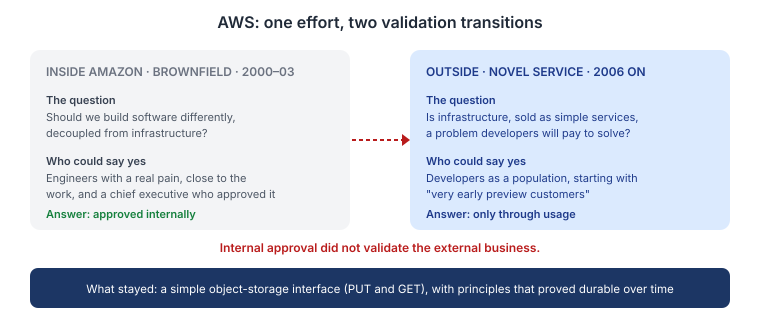
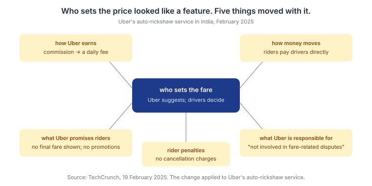
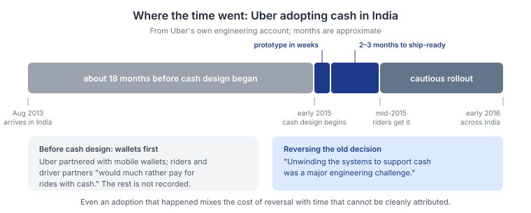
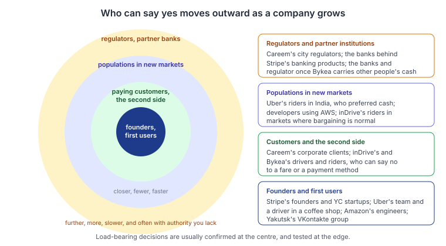
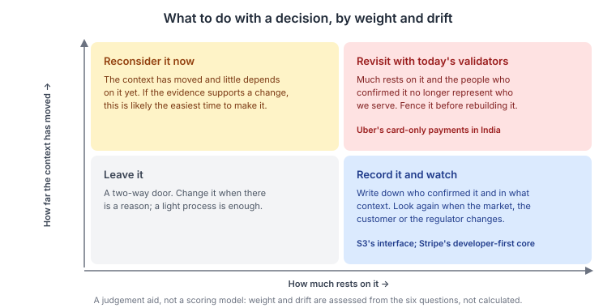

In [Who Can Say Yes](/systems/culture/scale/2026/11/05/who-can-say-yes/) I described four contrasts: startup and software house, greenfield and brownfield, project and product, novel idea and crowded market. I suggested that they are lenses rather than boxes, and that each changes who can confirm the decisions that matter, which I called the validation topology.

What I left out is that a company does not stay in one combination. As it grows, a project becomes a product, a novel idea becomes a crowded market, a greenfield system becomes a brownfield one, and the people who can say yes move with it. The decisions made at the start tend to stay. In [The Hollow Sprint](/systems/culture/scale/2026/10/09/the-hollow-sprint/) I called the ones whose reversal cascades load-bearing, and many of them are made early, when the people confirming them are close to the work and relatively few.

Put simply: a decision is validated in a context. The people confirming it know a particular customer, a particular market, a particular operating environment. As the company grows, new customers arrive, new markets bring different assumptions, and regulators and partners bring authority the original team never had to consider. The decision does not change with them. It stays in the architecture, the operating model and the promises the company has made. A decision does not carry its original validation with it forever.

This post looks at six companies whose early journeys are well documented: Uber, Careem, AWS, Stripe, inDrive and Bykea. I have relied on primary accounts and established publications, though they are not equally strong evidence, and I have no inside knowledge of any of these companies. What follows is a reading of public records through the lenses of the previous post, not a history of how these decisions were actually made.

---

## Uber: a novel service, confirmed by the people closest to it

Uber launched in San Francisco on 1 June 2010 [[1]](#ref-1) as an on-demand black car service, booked by app or text message at roughly one and a half to two times a taxi fare. The rider's pre-registered card was charged at the end of the trip, so no cash changed hands [[2]](#ref-2).

It was a **startup** with a **novel idea in a crowded market**, and the people who could confirm its early decisions were close and few. The team met a driver in coffee shops to ask whether "the real world would accept this idea," cold-called limousine drivers they found on Yelp, and handed out flyers at the Moscone Center [[1]](#ref-1). Riders had to register a card before their first trip [[2]](#ref-2). Under that topology, a card on file was an easy decision to confirm. Everyone who could say yes already had one.

Then the context moved. In July 2012, with peer-to-peer services such as Lyft already offering rides, Uber launched UberX at about 35% below its black cars [[3]](#ref-3). The novel idea had become a **crowded market** of its own. Abroad, Uber met validators who had never been in the room. In India in 2015, riders and drivers preferred cash, and Uber's engineers later wrote that "unwinding the systems to support cash was a major engineering challenge": fares had to be known before the trip ended, and Uber needed a new way to collect its own fee from drivers [[4]](#ref-4).

Uber did not abandon cards in India; it added cash beside them. But by then the system was **brownfield**, and supporting a second way to pay meant changing far more than the checkout screen.

## Careem: a corporate service, then a consumer product

Careem began in Dubai in 2012 as a corporate transportation website that helped businesses schedule transport for their employees [[5]](#ref-5). Its founders came from consulting, where, in one co-founder's words, they had seen that ground transport was "bad," from booking a car to paying for it [[6]](#ref-6). That gave Careem an identifiable group of people who could confirm whether it solved a real problem, the businesses arranging transport for their staff, and founders who brought domain knowledge from earlier work.

Then individuals wanted to use it too [[6]](#ref-6), and a service for corporate clients became a **product** for a population. In Saudi Arabia, where a co-founder put credit card penetration at around five percent, Careem accepted other payment methods, and women, who could not legally drive there until 2018 [[7]](#ref-7), were among its fastest-growing customers [[6]](#ref-6). It later set up a women-only call centre there [[5]](#ref-5), and built its own maps because addresses in many of its cities were unreliable [[8]](#ref-8).

Regulators mattered as much as riders. A co-founder described "a very localised execution," with city teams and regulator contacts [[6]](#ref-6), and in Abu Dhabi the service was suspended after a regulatory crackdown and later restored in a more limited form [[5]](#ref-5). Careem could know a city better than anyone. It still could not decide on the city's behalf whether it could operate.

## AWS: brownfield on the inside, novel on the outside

AWS is the clearest case I know of one effort sitting in two contexts at once.

On the inside it was **brownfield**. Around 2000 Amazon began looking for ways to simplify how it built software [[9]](#ref-9). By 2003, in the account of one of the engineers involved, "IT wasn't keeping up"; he and a colleague wrote up an approach based on decoupling applications from infrastructure, and Amazon's chief executive approved it [[10]](#ref-10). A widely circulated account by a former Amazon engineer describes a mandate from around the same period that every team expose its functionality through service interfaces "designed from the ground up to be externalizable" [[11]](#ref-11).

On the outside it was a **novel productization**. The same engineer has said that selling the infrastructure as a service "was not obvious at the beginning," and he denies the popular story that AWS grew out of renting spare retail capacity [[10]](#ref-10). His colleague led the early compute work from a small team in Cape Town [[9]](#ref-9). S3 launched on 14 March 2006 to make "web-scale computing easier for developers" [[12]](#ref-12), and EC2 went into beta that August, relying on feedback from "very early preview customers" [[9]](#ref-9). Internal approval did not validate the external business. Only developers, a population nobody could speak for, could do that, and only through usage.

What stayed is striking. S3 launched with two basic operations, PUT and GET, and AWS now describes security, durability, availability, performance and elasticity as fundamentals that have remained central to the service since launch [[12]](#ref-12). That is a retrospective description rather than proof of a single decision in 2006, but the original interface was simple, and the principles beneath it proved durable for twenty years in a market that was still nascent when the service launched.

## Stripe: when the founders are the validators

Stripe is the startup topology at its closest. Its two founders were developers building for developers, its earliest users were other Y Combinator startups, and when someone agreed to try Stripe the founders would say "Right then, give me your laptop" and set them up on the spot, a habit later held up, in a well-known essay, as a model of doing things that don't scale [[13]](#ref-13).

But it entered a **crowded market**. Stripe launched publicly in September 2011 at 2.9% plus 30 cents per charge, in line with PayPal [[14]](#ref-14), so it did not compete on price. It competed on a different load-bearing decision, stated in its launch: "We believe that enabling transactions on the web is a problem rooted in code, not finance." Merchants needed no separate merchant account or gateway, and card details went to Stripe rather than to the developer's servers [[14]](#ref-14). In [The CTO Decision Stack](/systems/culture/2026/06/07/cto-decision-stack/) I described that developer-first commitment as a decision that shaped every layer of the company beneath it.

As Stripe grew, the founders could no longer be the validators. In 2016 Atlas began incorporating companies in Delaware and opening US bank accounts for entrepreneurs abroad, with legal and tax advice from outside firms [[15]](#ref-15). Its later banking products rest on partner banks, and Stripe's own pages state that "Stripe is not a bank" [[16]](#ref-16). For those decisions the validators who matter most are banks and regulators: people who hold an authority Stripe does not have, however well it understands the problem.

## inDrive: validation built into the mechanism

In 2012, in Yakutsk in Siberia, a local resident created a group on the social network VKontakte to connect drivers and passengers directly, after local taxi companies kept raising fares. Within months it had 50,000 members, in a city of about 280,000 [[17]](#ref-17). inDrive built a form of two-sided agreement into the transaction itself: the rider proposes a fare, and a driver accepts it or counters [[17]](#ref-17). That is not the same as validating the pricing mechanism. A driver accepting one fare confirms that trip, not that the overall arrangement is sustainable or fair.

As inDrive expanded, to Kazakhstan, from 2018 to Latin America, and in early 2021 to Pakistan [[17]](#ref-17)[[18]](#ref-18), it entered **crowded markets** carrying the decision it had started with. The company itself says the model works best where bargaining is part of daily life, and less well where it is not, such as Japan and South Korea [[17]](#ref-17). And a marketplace has two populations. Riders gained lower fares; drivers interviewed by Rest of World in Pakistan described earning less for more work [[18]](#ref-18).

## Bykea: a crowded market, a different customer

Bykea launched in Karachi in December 2016 [[19]](#ref-19), a **startup** entering a **crowded market** with a customer the others were not built for. Its founder had founded the online marketplace Daraz.pk, and before that spent seven years as a director of operations [[19]](#ref-19). He saw smartphones and motorcycles as "often the only valuable assets of low income persons" [[19]](#ref-19), and the target users were small traders and shopkeepers. "We knew what we were doing would be considered uncool," he told Dawn [[20]](#ref-20).

Its early decisions followed from that choice of validator: motorbikes rather than cars, an app in Urdu, named zones rather than GPS coordinates, and riders working part-time, because in the founder's view nobody could spend more than about five hours a day riding in Karachi traffic [[21]](#ref-21). Most trips were settled in cash, which gave riders money in hand rather than a payout at the end of the week, and the riders' acceptance of these arrangements mattered: Dawn reported that some cancelled trips when the fare would be paid from the in-app wallet [[20]](#ref-20).

Then the context moved. Riders already carried parcels as well as passengers [[19]](#ref-19), and in 2020 Bykea Cash had them collect cash from customers' doorsteps to pay bills, transfer money to bank accounts and top up mobile wallets [[22]](#ref-22). A transport network was now carrying other people's money, and the founder said fintechs should work with banks rather than try to replace them [[22]](#ref-22). In my own field, that is the point at which a new set of validators arrives: the banks and the regulator, who decide what a network handling money is allowed to do.

---

## What the established players did not adopt

There is a second kind of evidence that is just as public: what a company chose not to change when a rival's different decision clearly worked.

inDrive's negotiated fare is the clearest case. It grew quickly in markets such as Pakistan, yet open bargaining has not become the way Uber or Careem work. They did respond, but in a particular shape. **Careem** launched Flexi Ride in November 2023, a separate ride option with bids held within 15% either side of a recommended fare [[23]](#ref-23). **Uber** launched Uber Flex in India in October 2023, where riders choose from nine price points above a floor Uber sets [[24]](#ref-24). In February 2025 it went further for auto-rickshaws in India, following local rivals Namma Yatri and Rapido: a daily fee in place of its commission, no final fare shown, riders paying drivers directly, and Uber no longer "involved in fare-related disputes between riders and drivers" [[25]](#ref-25)[[26]](#ref-26).

So the established players could add negotiation. What they did not do was make it the core of the product. Every response was bounded in price, confined to particular markets or vehicle types, or kept beside the main service. The public record does not establish why they chose these limits, but it does show what Uber's pricing is connected to.

- **Price balances the market.** During a New Year's Eve outage that switched surge pricing off, Uber's own economists found waiting times rose to eight minutes and a quarter of ride requests went unfulfilled [[27]](#ref-27).
- **Price is a promise to the rider.** Uber moved to upfront fares in 2016 because riders who knew the cost in advance came back more often: "no math and no surprises" [[28]](#ref-28). Bargaining is the opposite promise.
- **Price is tied to who is responsible.** When the UK Supreme Court ruled in 2021 that Uber's drivers were workers, the first factor it emphasized was that "it is Uber that sets the fare and drivers are not permitted to charge more" [[29]](#ref-29).
- **The core still fits the core markets.** inDrive itself says its model works best where bargaining is part of daily life [[17]](#ref-17). Changing the core to win those markets would mean breaking it where it already works.

And when Uber did hand fares to drivers for Indian auto-rickshaws, the commission, the payment flow, promotions, cancellation charges and fare disputes all moved with it [[25]](#ref-25).

That is, to me, the clearest picture of a load-bearing decision in this whole story. Who sets the price looks like a pricing feature. When it moved, the revenue model, the money flow, the customer promise and the company's responsibilities moved with it. So the established players adapted at the edges, where the decision could vary without disturbing what the rest of the business stood on.

### How long it took to follow

Timing makes the same point from another angle. One boundary first: these intervals are historical adoption gaps, not comparable measures of engineering effort or reversal cost.

**Uber** adopted motorbikes fastest. Bykea launched in December 2016 [[19]](#ref-19), and uberMOTO came to Lahore in March 2018, inside the same app, on the same dispatch, fare and commission [[30]](#ref-30). Cash took longer. Uber arrived in Dubai in 2013 [[8]](#ref-8) and offered cash across the Middle East only around 2016, after a pilot in Beirut [[31]](#ref-31). In India it arrived in August 2013 [[32]](#ref-32) and rolled cash out from mid-2015 [[4]](#ref-4); having rebuilt once, it could launch in Pakistan in 2016 with cash from the start [[33]](#ref-33). The daily fee for auto-rickshaws came a little over two years after Namma Yatri launched that model in November 2022 [[25]](#ref-25)[[26]](#ref-26), and Ola followed, extending it to cabs [[34]](#ref-34). Negotiated fares took longest: inDrive entered India in 2019 [[17]](#ref-17), four to six years before Uber's bounded responses.

**Careem** adopted motorbikes in about eleven months, launching in Karachi in November 2017 [[35]](#ref-35), before Uber did. Its answer to negotiated fares came under three years after inDrive reached Pakistan [[18]](#ref-18)[[23]](#ref-23), faster than Uber in India but fenced more tightly. Its core had much the same shape as Uber's, and by 2023 its ride-hailing business was also part of Uber, while a majority of its separate super app had been sold to the UAE's e& [[36]](#ref-36). I cannot tell from outside which of these mattered most.

### The same pattern outside ride-hailing

Cloud and payments show the same shape. EC2 went into beta in August 2006 [[9]](#ref-9). Google and Microsoft had each first chosen to sell a managed platform, and about six years later added virtual machines beside it rather than in its place: Google Compute Engine in June 2012, explicitly as a complement to App Engine [[37]](#ref-37), and Azure virtual machines in beta that June, generally available in April 2013 [[38]](#ref-38). AWS, in turn, already had its own container service when Kubernetes reached 1.0 in July 2015 [[39]](#ref-39), and added managed Kubernetes beside it in June 2018 [[40]](#ref-40), "late to the managed-Kubernetes party," as one analysis put it [[41]](#ref-41).

Stripe took about eight years to follow Square into in-person payments. Square's iPhone app arrived in May 2010 [[42]](#ref-42); Stripe Terminal came in September 2018, built in Stripe's own shape, as SDKs and APIs with partner card readers pre-certified for its platform. "As a software developer, you should be able to set up payments once, and have it work everywhere you need it to," its co-founder said [[43]](#ref-43). Stripe waited, whether by choice or necessity, until it could offer in-person payments without moving its developer-first core.

Some bought instead, as PayPal did with the developer-focused gateway Braintree two years after Stripe's launch [[44]](#ref-44). I come back to buying below.

I want to be careful with all of these. A delay also reflects how big the rival looked, how much the market mattered and what else the company was doing. inDrive's first Indian city was Chandigarh [[45]](#ref-45), and a small rival in a small city may not have warranted a response for years. What the timing does show is narrower. The adoptions that took about a year generally added something on top of existing decisions. The ones that took years involved changes to pricing, money flows or operating assumptions, and almost all of them arrived beside the original decision, fenced, or bought, rather than in place of it. That pattern is consistent with the dependencies described above, although the timelines alone cannot establish what caused each company to wait.

### Constraint or choice?

That raises a question the timing cannot answer. Did a company hold back because an earlier load-bearing decision made the change expensive, or because it believed in its own way of doing things?

The public record occasionally lets you look closer. Uber arrived in India in August 2013 [[32]](#ref-32), with card payments. Its engineers wrote that cards worked less smoothly there, so Uber first partnered with mobile wallet providers, which still did not fully solve the problem, and riders and driver partners "made it clear that they would much rather pay for rides with cash." In early 2015 the team began sketching the cash experience, had a working prototype within weeks, took two to three months more to make it ready to ship, and rolled it out cautiously from mid-2015 into early 2016 [[4]](#ref-4).

Most of that delay came before the cash work started. The unwinding the engineers called a major challenge took months. For the year and a half before it, the account records a wallet partnership tried first and says little else; the time may have gone to deciding, to waiting for stronger evidence, or to other priorities. So even an adoption that eventually happened mixes the cost of reversing an old decision with time that, from outside, cannot be cleanly attributed.

And I am less sure now that choice and constraint are really separate. Stripe's developer-first approach began as a philosophy about who its customer was. Once an API, documentation, a culture and a reliability bar had been built on it, it was also a load-bearing decision, and in-person payments had to take its shape. Uber's upfront fare began as a choice about what to promise riders, and became something a pricing change would have to break. A philosophy becomes load-bearing the moment enough is built on it. What began as a choice can become a constraint, and what looks like a constraint from outside may still be a deliberate choice.

## Technology choices made for speed

Technology choices are validated against an initial context too: the team's skills, the deployment environment, the expected scale and the time available. They are usually made for the first release, and the people who confirmed them may not be the people who later have to live with them.

I have seen it in my own work. One software house I worked with built a middleware product entirely on the Microsoft stack, C++ on Windows and .NET, to get to market quickly. That tied the product to Windows, and the company then struggled for years to make it run on Linux. Other software houses I know chose a hybrid framework, Ionic, for mobile apps for the same reason, struggled with it, and eventually outsourced native Android and iOS versions to another company. Both decisions were sensible for the first release. Both became load-bearing for everything after it.

The public record has well-known versions of the same story. Facebook's chief executive called its HTML5 mobile bet "one of the biggest mistakes if not the biggest strategic mistakes we've ever made," after rebuilding its iOS app natively [[46]](#ref-46). Airbnb sunset React Native in 2018, having ended up maintaining code on three platforms instead of two [[47]](#ref-47). At Twitter, traffic peaks around the 2010 World Cup caused major stability problems; a review found what it described as the world's largest Ruby on Rails installation, one codebase with a monolithic team, and it re-architected into services on the JVM [[48]](#ref-48). And Microsoft itself had to move too. .NET Core, released in June 2016, gave developers a single codebase targeting Windows, Linux and macOS [[49]](#ref-49), and Microsoft built a platform abstraction layer under tens of millions of lines of code so that SQL Server could run on Linux, shipping it in 2017 [[50]](#ref-50). That is close to the middleware story above, at a much larger scale: the stack's own maker found its context had moved.

LinkedIn's mobile lead put it most simply when the company moved to native in 2013: the HTML5 approach "worked really well when mobile only made up 8 to 10 percent of traffic" [[51]](#ref-51). That sentence is the whole argument of this post in miniature. None of these decisions was wrong when it was made. What changed was the context, and because so much had been built on the original choice, changing it took a rewrite, a migration or, for some, another company.

## Make or buy

Buying looks like a way out of a slow decision. When a rival's approach clearly works, or a capability would take years to build, a company can buy it, as PayPal did with Braintree [[44]](#ref-44). In payments it is common to buy a switch, a core system or a fraud engine rather than build one. But make or buy is itself a load-bearing decision, and I think it is often treated as more reversible than it is.

Conway's law offers one way to see why. The 1968 paper that gave the law its name observed that organizations which design systems "are constrained to produce designs which are copies of the communication structures of these organizations" [[52]](#ref-52). If that holds, a bought system is not neutral. It carries the shape of the organization that built it. In [The Cognitive Load Ceiling](/systems/scale/2026/03/23/cognitive-load-ceiling/) I argued that AI-generated code presents a related problem: it can carry assumptions inherited from the models and the generation process, even when the team responsible for it did not explicitly make those choices.

In that sense we are not only buying a product. We are inheriting part of another organization's development culture: its assumptions, boundaries and working practices. Those were validated in its own context, by its own customers and regulators. When our context moves, either our organization reshapes itself around the purchase or the purchase has to be reshaped. Either way, the integration can cost more than the change it was meant to avoid. Building is not free of this either: a team tends to build what its own structure makes easy. The question for both is the same one this post keeps asking: whose context was this validated in, and how far is that from ours, now and as ours moves?

## The topology moves

Put side by side, the six journeys look like this.

A few patterns stand out to me.

**Each company began with a relatively narrow set of people who could confirm whether its initial proposition worked.** They were close to the problem, though the source of their knowledge and the authority they held differed: founders who were their own users, a driver in a coffee shop, corporate clients, an internal engineering team and an executive who approved its idea, a city's frustrated passengers, a founder who knew his customers' lives. That narrowness is what made fast early decisions possible, and each of the early decisions that shaped the business took shape under the conditions and among the people who could validate it at the time.

**As the companies grew, the validators multiplied and moved outward:** riders in new markets, the second side of a marketplace, developers as a population, and at the outer edge regulators and partner banks, who can decide what a company is allowed to do however much the company knows.

**Some early decisions held, some met a later no, and some were fenced.** S3's fundamentals and Stripe's developer-first design have lasted. Uber's card-only assumption did not survive India, and Bykea's riders pushed back on wallet payments. Uber's platform-set price met inDrive's negotiated one, and Uber varied it only at the edges. These decisions were confirmed under their respective initial conditions, by people who were close to the problem but differed in what they knew and what they had authority to decide. The difference was whether the later validators would have said yes too, and how much else was built on the decision when they did not. What stays, then, is not always the original decision in its unchanged form. Often it is what was built on it: the architecture, the operating model and the dependencies that make it expensive to move.

**The lenses combine, and they shift.** AWS was brownfield and novel at the same time. Careem moved from a service for companies to a product for individuals, and then into a crowded market. Uber's novel idea became the crowded market others entered. The six do not all show the same thing, and the evidence is stronger for some than others, but they are different forms of one pattern.

## What AI changes

AI shortens the time needed to build and to reproduce visible capabilities. It does not make the context those capabilities must operate in any simpler: entering a market or launching a payments product still depends on licences, banking partners, regulators and operations.

The clearest recent example I know comes from AI products themselves. Google introduced Deep Research for Gemini in December 2024 [[53]](#ref-53), and OpenAI launched its own deep research agent on 2 February 2025 [[54]](#ref-54). Two days later, a team at Hugging Face published an open version from what began as a 24-hour challenge, which scored about 55% on the GAIA benchmark's validation set against OpenAI's 67% [[55]](#ref-55). On 15 February Perplexity launched its own [[56]](#ref-56). Where a motorbike option took the best part of a year, a recognizable version of a new kind of product appeared within days. It was not equivalent to the original, and the Hugging Face team pointed to the web-browsing tool OpenAI had built for an earlier product as the likely source of much of the remaining gap [[55]](#ref-55). The visible feature could be reproduced in a day. The decisions and infrastructure beneath it could not.

I suspect this makes the pattern above more important, not less. The example does not show it directly, but it seems a likely consequence: decisions confirmed under early conditions can now be built on faster, by more code and more agents, before the later validators ever see them. The question that matters is not only "who confirmed this?" It is "does the person who confirmed it still represent who we serve now?"

Adopting AI is itself one of these decisions. Once a team's way of delivering software is built around a particular model, vendor and workflow, that choice has spread and outside dependents of its own. Its initial validators are often the engineers who trialled the tools and set up the workflow. Its consequences reach further: to security teams, auditors, customers and, in regulated environments, regulators who may later ask how the code was produced, reviewed and approved. And while AI has lowered the cost of a rewrite, as I argued in The Cognitive Load Ceiling, it lowers only the part of a decision that lives in code. Uber's change to who sets the price was costly because of the revenue model and responsibilities attached to it, not because of how much code had to change.

## What I would do as a CTO

None of this is an argument against early decisions. Fast early decisions, made by a narrow group close to the problem, are what made these companies possible. The harder part is telling which of them will carry weight, and knowing when to look at them again.

Amazon's own vocabulary is a good starting point: "Many decisions are reversible, two-way doors. Those decisions can use a light-weight process" [[57]](#ref-57). The difficulty is that a load-bearing decision rarely looks like a one-way door when it is made. A two-way door can become a one-way door as more is built behind it. A card on file or a platform-set price looked like a product detail. What made them load-bearing was what was built on them afterwards, and what changed around them. So rather than classifying a decision once, when it is made, I would keep asking a few questions about it as the organization changes. This is my own working list, not an established method.

The first four questions describe weight: how much would move if the decision moved. The last two describe drift: how far the decision now sits from the context that confirmed it. This is not the same as technical debt, or the comprehension debt I described in The Cognitive Load Ceiling. Debt is a shortfall, often a shortcut taken knowingly, that accumulates interest. A load-bearing decision can be entirely right when it is made, as S3's interface and Uber's card on file were, and become a problem only because the context moved. Both can become more costly over time as their consequences accumulate. Put together, the questions suggest what to do.

Three habits follow. First, for each decision with real weight, record not just who confirmed it, but in what context: which market, which customers, which regulator, at what stage. Second, treat any move in context, a new market, a new customer segment, a regulated product, as a moment to revisit those records. That is the Default question from the decision map in Who Can Say Yes, asked at the scale of the company. Third, when a rival's different decision clearly works, ask what our version of that decision is connected to. The useful choice is often not whether to adopt it, but where the change can be fenced so that the core does not have to move, and if the answer is to buy, whose context the purchase was validated in.

## What this does not show

**It is a reading from outside.** Public accounts show what these companies built and some of what their founders said. They do not show what was considered and rejected, or how close a decision came to going the other way.

**It is hindsight, mostly about survivors.** These six are well documented because they became well known. What survivors chose not to change is often as visible as what they changed, but the record still says what they did, not why. The reasons I have given for the response to negotiated fares are my reading of what Uber's pricing is connected to, not an explanation the company has offered.

**The lenses are mine.** None of these companies described itself in terms of validation topology. I am applying a frame to their stories, not reporting theirs.

## The context moves

Each of these companies began with a relatively narrow set of people who could confirm whether its initial proposition worked, and made decisions there that the rest of the business was built on. As the companies grew, the context moved, and those decisions had to meet people who had never been part of the original conversation.

That seems to me to be the real test of a load-bearing decision: not whether the first validators said yes, but whether the later ones would have.

---

## Sources

[1] Fortune, "Uber: An oral history" (3 June 2015). [fortune.com](https://fortune.com/2015/06/03/uber-an-oral-history)

[2] TechCrunch, "UberCab Takes The Hassle Out Of Booking A Car Service" (5 July 2010). [techcrunch.com](https://techcrunch.com/2010/07/05/ubercab-takes-the-hassle-out-of-booking-a-car-service/)

[3] TechCrunch, "Uber Opens Up Platform To Non-Limo Vehicles With 'Uber X,' Service Will Be 35% Less Expensive" (1 July 2012). [techcrunch.com](https://techcrunch.com/2012/07/01/uber-opens-up-platform-to-non-limo-vehicles-with-uber-x-service-will-be-35-less-expensive)

[4] Uber Engineering, "An Uber Engineer Discusses Cash for India Growth and Beyond." [uber.com](https://www.uber.com/blog/india-growth-cash-payments/)

[5] The National, "Careem blazes a trail for Middle East tech start-ups" (2 December 2017). [thenationalnews.com](https://www.thenationalnews.com/business/technology/careem-blazes-a-trail-for-middle-east-tech-start-ups-1.680664)

[6] Arabian Business, "In the driving seat: Careem" (9 June 2015). [arabianbusiness.com](https://www.arabianbusiness.com/in-driving-seat-careem-595522.html)

[7] Dawn (AFP), "Saudi women take the wheel as the Kingdom lifts the world's last remaining ban on females driving" (24 June 2018). [dawn.com](https://www.dawn.com/news/1415805)

[8] CNN, profile of Careem as Dubai's ride-hailing startup (1 March 2017). [cnn.com](https://edition.cnn.com/2017/03/01/middleeast/careem-dubai-startup/index.html)

[9] TechCrunch, "How Amazon EC2 grew from a notion into a foundational element of cloud computing" (28 August 2021). [techcrunch.com](https://techcrunch.com/2021/08/28/how-amazon-ec2-grew-from-a-notion-into-a-foundational-element-of-cloud-computing)

[10] Network World, "The myth about how Amazon's Web service started just won't die." [networkworld.com](https://www.networkworld.com/article/936248/the-myth-about-how-amazon-s-web-service-started-just-won-t-die.html)

[11] Steve Yegge, "Stevey's Google Platforms Rant" (2011). [washington.edu](https://courses.cs.washington.edu/courses/cse452/23wi/papers/yegge-platform-rant.html)

[12] AWS News Blog, "Twenty years of Amazon S3 and building what's next." [aws.amazon.com](https://aws.amazon.com/blogs/aws/twenty-years-of-amazon-s3-and-building-whats-next)

[13] Paul Graham, "Do Things that Don't Scale" (2013). [paulgraham.com](https://paulgraham.com/ds.html)

[14] TechCrunch, "Sequoia-Backed Stripe Launches To Disrupt The Online Payments Industry With A Developer-Friendly Platform" (30 September 2011). [techcrunch.com](https://techcrunch.com/2011/09/30/sequoia-backed-stripe-launches-to-disrupt-the-online-payments-industry-with-a-developer-friendly-platform)

[15] Inc., "Stripe Makes a Big Bet on Letting Anyone, Anywhere, Start a U.S. Business" (24 February 2016). [inc.com](https://www.inc.com/maria-aspan/stripe-atlas-business-licenses.html)

[16] Stripe, Stripe Treasury product page and disclosures. [stripe.com](https://stripe.com/newsroom/news/treasury)

[17] Rest of World, on inDriver's origins in Siberia (2022). [restofworld.org](https://restofworld.org/2022/indriver-siberia-russia/)

[18] Rest of World, on inDrive drivers in Pakistan (2023). [restofworld.org](https://restofworld.org/2023/indrive-pakistan-drivers-underpaid/)

[19] Arab News Pakistan, on Bykea and its founder (8 May 2019). [arabnews.pk](https://arabnews.pk/node/1494316)

[20] Dawn, "Tech talk: Bykea vrooms itself into a hyperlocal marketplace" (29 July 2018). [dawn.com](https://www.dawn.com/news/1423552)

[21] TechCrunch, "How Bykea is winning Pakistan's ride-hailing and delivery market" (31 January 2020). [techcrunch.com](https://techcrunch.com/2020/01/31/how-bykea-is-winning-pakistans-ride-hailing-and-delivery-market)

[22] MENAbytes, on the launch of Bykea Cash (21 January 2020). [menabytes.com](https://www.menabytes.com/bykea-cash-pakistan/)

[23] Rest of World, on fare-bidding apps and Careem in Pakistan, including Flexi Ride's limit of 15% either side of the recommended fare (June 2024). [restofworld.org](https://restofworld.org/2024/careem-indrive-pakistan/)

[24] TechCrunch, on Uber Flex in India (5 January 2024). [techcrunch.com](https://techcrunch.com/?p=2647258)

[25] TechCrunch, "Uber ditches commissions in favor of fees for auto rickshaw drivers in India" (19 February 2025). [techcrunch.com](https://techcrunch.com/2025/02/19/uber-ditches-commissions-in-favor-of-fees-for-auto-rickshaw-drivers-in-india)

[26] Inc42, "Ola, Uber & The Zero-Commission U-Turn" (27 June 2025). [inc42.com](https://inc42.com/features/ola-uber-the-zero-commission-u-turn)

[27] Jonathan Hall, Cory Kendrick and Chris Nosko, "The Effects of Uber's Surge Pricing: A Case Study," Uber. [uber.com](https://www.uber.com/blog/research/the-effects-of-ubers-surge-pricing-a-case-study)

[28] TechCrunch, on Uber's move to upfront fares (23 June 2016). [techcrunch.com](https://techcrunch.com/2016/06/23/surgepurge)

[29] UK Supreme Court, *Uber BV and others v Aslam and others* [2021] UKSC 5, press summary (19 February 2021). [supremecourt.uk](https://www.supremecourt.uk/press-summary/uksc-2019-0029.html)

[30] ProPakistani, "Uber Introduces Its Bike-Hailing uberMOTO Service in Lahore" (27 March 2018). [propakistani.pk](https://propakistani.pk/2018/03/27/uber-introduces-its-bike-hailing-ubermoto-service-in-lahore/)

[31] Uber, on cash payments across the Middle East and North Africa (2016). [uber.com](https://www.uber.com/blog/menacash)

[32] YourStory, "Uber enters India; rolls out first in Bangalore" (August 2013). [yourstory.com](https://yourstory.com/2013/08/uber-enters-india-rolls-out-first-in-bangalore/)

[33] PYMNTS, "Uber launches in Pakistan and will let riders pay cash" (2016). [pymnts.com](https://www.pymnts.com/cpi-posts/pakistan-uber-launches-and-will-let-riders-pay-cash/)

[34] MediaNama, "Ola expands zero-commission model to cab drivers" (19 June 2025). [medianama.com](https://www.medianama.com/2025/06/223-ola-expands-zero-commission-model-to-cab-drivers/)

[35] Profit, "Careem to launch 'Careem Bike' services in Karachi tomorrow" (2 November 2017). [profit.pakistantoday.com.pk](https://profit.pakistantoday.com.pk/2017/11/02/careem-to-launch-careem-bike-services-in-karachi-tomorrow)

[36] Wamda, "e& acquires majority stake in Careem Super App" (April 2023). [wamda.com](https://www.wamda.com/en/2023/04/e-acquires-majority-stake-careem-super-app-400-million)

[37] Google Cloud Platform Blog, "Google Compute Engine launches" (28 June 2012). [googleblog.com](https://cloudplatform.googleblog.com/2012/06/google-compute-engine-launches.html)

[38] InfoQ, on Windows Azure infrastructure services reaching general availability (April 2013). [infoq.com](https://www.infoq.com/news/2013/04/microsoft-iaas)

[39] InfoQ, "Kubernetes tagged v1.0" (17 July 2015). [infoq.com](https://www.infoq.com/news/2015/07/kubernetes-tagged-v1/)

[40] Amazon, "AWS announces general availability of Amazon EKS" (5 June 2018). [aboutamazon.com](https://press.aboutamazon.com/2018/6/aws-announces-general-availability-of-amazon-eks)

[41] SiliconANGLE, on Amazon EKS reaching general availability (5 June 2018). [siliconangle.com](https://siliconangle.com/blog/2018/06/05/amazon-fires-elastic-container-service-kubernetes/)

[42] TechCrunch, "Square's iPhone App Hits The App Store" (10 May 2010). [techcrunch.com](https://techcrunch.com/2010/05/10/squares-iphone-app-hits-the-app-store)

[43] Stripe, "Stripe announces Stripe Terminal, a programmable point of sale for in-person payments" (17 September 2018). [stripe.com](https://stripe.com/en-ca/newsroom/news/stripe-launches-terminal)

[44] TechCrunch, on PayPal's acquisition of Braintree (26 September 2013). [techcrunch.com](https://techcrunch.com/2013/09/26/paypal-acquires-payments-gateway-braintree-for-800m-in-cash)

[45] PhocusWire, "inDriver launches in India." [phocuswire.com](https://www.phocuswire.com/inDriver-ride-hailing-launches-in-India)

[46] Engadget, on Facebook's chief executive calling the HTML5 bet a mistake (11 September 2012). [engadget.com](https://www.engadget.com/2012-09-11-zuckerberg-html-5-facebook-mobile-app-mistake.html)

[47] Airbnb Engineering, "Sunsetting React Native" (19 June 2018). [medium.com](https://medium.com/airbnb-engineering/1868ba28e30a)

[48] InfoQ, on Twitter's re-architecture and its tweets-per-second record (26 August 2013). [infoq.com](https://www.infoq.com/news/2013/08/scaling-twitter/)

[49] InfoQ, on the release of .NET Core 1.0 (5 July 2016). [infoq.com](https://www.infoq.com/news/2016/07/netcore1-released)

[50] TechCrunch, "How Microsoft brought SQL Server to Linux" (17 July 2017). [techcrunch.com](https://techcrunch.com/2017/07/17/how-microsoft-brought-sql-server-to-linux/)

[51] VentureBeat, on why LinkedIn moved from HTML5 to native apps (17 April 2013). [venturebeat.com](https://venturebeat.com/dev/linkedin-mobile-web-breakup)

[52] Melvin E. Conway, "How Do Committees Invent?", Datamation (April 1968). [melconway.com](https://www.melconway.com/Home/Committees_Paper.html); summary at [The Morning Paper](https://blog.acolyer.org/2019/12/13/how-do-committees-invent/)

[53] TechCrunch, "Google Gemini can now do more in-depth research" (11 December 2024). [techcrunch.com](https://techcrunch.com/2024/12/11/gemini-can-now-research-deeper/)

[54] TechCrunch, "OpenAI unveils a new ChatGPT agent for 'deep research'" (2 February 2025). [techcrunch.com](https://techcrunch.com/2025/02/02/openai-unveils-a-new-chatgpt-agent-for-deep-research/)

[55] Hugging Face, "Open-source DeepResearch – Freeing our search agents" (4 February 2025). [huggingface.co](https://huggingface.co/blog/open-deep-research)

[56] TechCrunch, "Perplexity launches its own freemium 'deep research' product" (15 February 2025). [techcrunch.com](https://techcrunch.com/2025/02/15/perplexity-launches-its-own-freemium-deep-research-product/)

[57] Amazon, 2016 Letter to Shareholders (April 2017). [aboutamazon.com](https://www.aboutamazon.com/news/company-news/2016-letter-to-shareholders)
